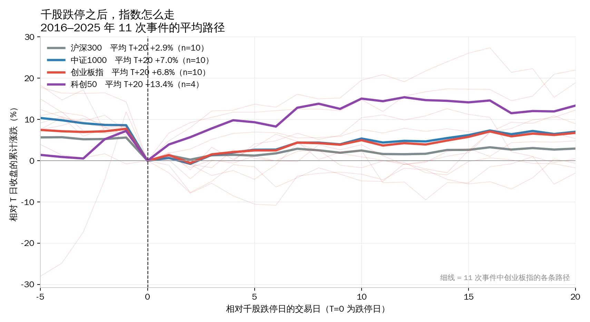
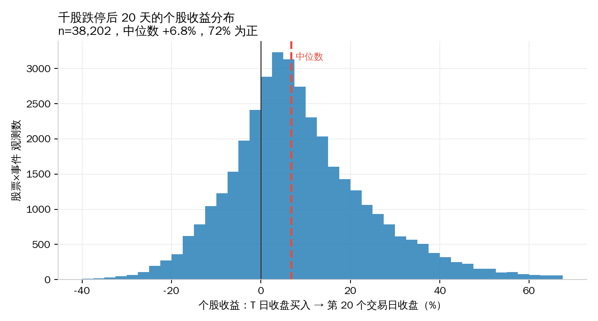
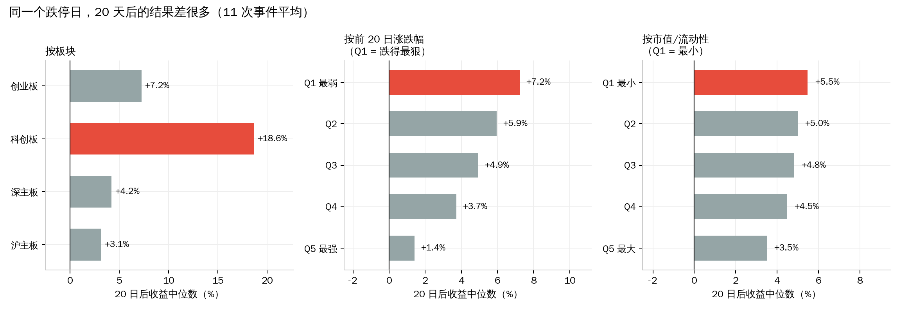
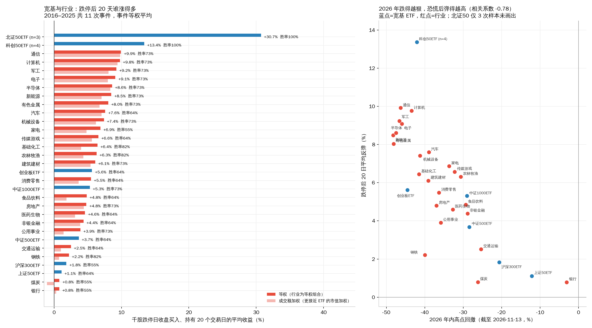

# 千股跌停之后抄什么：11 次样本复盘（2016–2025）

> 数据：本地 QuantDB 全 A 日线（不复权算涨跌停，后复权算收益），2016-01-04 ~ 2026-11-13。
> 事件定义：全市场当日跌停家数 ≥ 1000 的交易日，共 **11 次**。
> 统计口径：T 日收盘买入、持有到 T+20 收盘；每个事件内先算分组中位数，再对 11 次事件等权平均。
> 局限：样本少且高度相关（2016 年 1 月占 3 次）、退市股不在库（幸存者偏差）、未计交易成本。

---

## 一句话结论

**千股跌停后 20 天，胜率约 7 成、中位 +6.8%；但要赚超额，抄的是「跌得最惨 + 弹性最大」的一头 —— 创业板/科创板、前期 20 日跌得最狠、小市值，而不是抗跌的银行、煤炭、高股息。**

例外只有一种：**泡沫破裂中继 + 制度性失灵（2016 年 1 月熔断）时，第一批千股跌停不是底。**

---

## 一、总览：抄底整体是正期望，但方差很大

- 38,202 个「股票 × 事件」观测：**71.6% 为正**，中位数 **+6.8%**，均值 +9.5%
- 分位数：10% 分位 **−9.5%**，25% 分位 −1.2%，75% 分位 +17.4%，90% 分位 +30.9%





**20 日窗口内指数平均表现（同口径，等权 11 次事件）：**

| 指数 | 平均 T+20 | 备注 |
|---|---|---|
| 科创 50 | **+13.4%** | 仅 4 次样本（2019 年后才有） |
| 中证 1000 | **+7.0%** | n=10（2016-01-07 因数据窗口不足剔除） |
| 创业板指 | **+6.8%** | 离散度最大 |
| 沪深 300 | +2.9% | |
| 上证 50 | +1.1% | 几乎白干 |

> 只数「跌停家数」不看结构，会漏掉最重要的一条：**大票负责止跌，小票负责反弹。**

---

## 二、逐次事件明细（这才是关键）

| 日期 | 跌停家数 | 事前 250 日回撤¹ | 上证 T+20 | 个股中位 T+20 | 个股上涨占比 | 性质 |
|---|---|---|---|---|---|---|
| 2016-01-07 | 1681 | −7.0% | **−11.0%** | **−11.8%** | 10.5% | 泡沫破裂中继 + 熔断失灵 |
| 2016-01-11 | 1279 | −10.3% | −9.0% | −6.4% | 25.6% | 同上 |
| 2016-01-26 | 1160 | −18.2% | −0.6% | −3.2% | 32.9% | 杀到尾声 |
| 2016-02-25 | 1447 | −18.5% | +8.0% | +8.1% | 89.8% | 底部区域二次确认 |
| 2018-06-19 | 1148 | −18.3% | −3.8% | +2.0% | 61.2% | 贸易战开打 |
| 2018-10-11 | 1171 | −27.4% | +2.0% | +4.0% | 71.8% | 外盘+去杠杆尾声 |
| 2019-05-06 | 1104 | −11.1% | −0.6% | +0.7% | 53.0% | 关税推特 |
| 2020-02-03 | 2972 | −16.0% | +8.2% | +10.9% | 91.3% | 疫情一次性冲击（V 底） |
| 2024-02-05 | 1416 | −20.4% | **+13.1%** | **+25.1%** | 98.1% | 微盘流动性危机（最强反弹） |
| 2024-10-09 | 1078 | −6.6% | +3.8% | +7.9% | 82.2% | 政策脉冲后回调 |
| 2025-04-07 | 3126 | −11.3% | +8.2% | +14.0% | 94.2% | 关税冲击（V 底） |

**读法：**
- 事前跌得深的（2016-01-26、2016-02-25、2018-10-11、2020-02-03、2024-02-05）—— 指数 20 日 4 正 1 平，个股中位 4 正 1 小负（2016-01-26 为 −3.2%）；
- 泡沫破裂中继 + 制度失灵（2016-01-07）—— 20 日 −11.8%，是唯一「谁抄谁死」的样本；
- 外部一次性冲击（疫情、关税）—— 反弹最快，20 日就修复，不用等二次探底；
- 只有 **2016 / 2018** 两段在指数层面还创了新低（T+20 内最大回撤 −15% / −6%），其余 5 次 T 日基本就是阶段低点。

¹ 回撤按「库内 250 日高点」计算；本地库起点为 2016-01-04，故 2016 年 3 次事件的回撤被系统性低估（当时实际处于 2015 年泡沫破裂后的下跌途中）。

---

## 三、抄什么：四层排序



### 1）板块：越「成长」越好
| 板块 | 中位 T+20 | 事件胜率 |
|---|---|---|
| 科创板 | **+18.6%** | 4/4（样本少） |
| 创业板 | **+7.2%** | 8/11 |
| 深主板 | +4.2% | 8/11 |
| 沪主板 | +3.1% | 8/11 |

### 2）超跌度：不要买抗跌的
按事件内「前 20 日涨跌幅」五等分：

| 分组 | 中位 T+20 |
|---|---|
| Q1 跌得最狠 | **+7.2%** |
| Q2 | +5.9% |
| Q3 | +4.9% |
| Q4 | +3.7% |
| Q5 最抗跌/最强 | **+1.4%** |

**这条是全样本里最稳定的规律：11 次里 8 次 Q1 跑赢 Q5。** 强势股在跌停日之后往往是补跌主力。

### 3）市值：小盘优于大盘
| 分组（20 日均成交额） | 中位 T+20 |
|---|---|
| Q1 最小 | **+5.5%** |
| Q5 最大 | +3.5% |

沪深 300 成分股 +2.2%，非成分 +4.8%。

> 注意：跌停的票 vs 没跌停的票，20 日收益几乎一样（+4.8% vs +4.4%）。**决定收益的是「之前跌了多少」，不是「今天有没有跌停」。**

### 4）行业：买科技制造，躲防御
按「相对全市场中位数的超额」排序（≥8 次事件样本）：

| 靠前 | 超额 | 靠后 | 超额 |
|---|---|---|---|
| 专业连锁* | +5.8% | 全国性银行 | **−5.0%** |
| 教育培训* | +5.3% | 煤炭开采 | −4.6% |
| 其他电子 | +4.8% | 保险 | −4.5% |
| 金属新材料 | +4.4% | 普钢 | −4.5% |
| 军工电子 | +4.3% | 航运港口 | −4.5% |
| 通信设备 | +4.1% | 航空机场 | −3.9% |
| 航空装备 | +4.1% | 燃气 | −3.4% |
| 其他发电设备 | +3.3% | 饰品 | −3.5% |

\*样本量小（<15 只），仅作参考。

**券商不是最优解**：11 次里 7 次跑输，2024/2025 三次分别 −10.7% / −7.1% / −6.9% —— 它只在「政策底」叙事里才有超额。

---

## 四、什么时候能抄、什么时候别急

| 情形 | 历史样本 | 打法 |
|---|---|---|
| **外部一次性冲击**（疫情、关税、外盘暴跌） | 2020-02、2025-04 | V 底，当天尾盘就买，20 日修复；买弹性最大的 |
| **内部流动性危机**（微盘、两融、质押、量化平仓） | 2024-02、2018-10 | 先跌停→再跌停，**分批**，等第二次探底或缩量 |
| **泡沫破裂中继 + 制度失灵** | 2016-01 | **第一批跌停不抄**，等指数再跌 10%+ 或换手萎缩 |

**自检三问：**
1. 跌之前指数在什么位置？（250 日高点回撤 >15% → 可以抄；刚创完新高 → 别急）
2. 触发因素是外部还是内部？（外部 → 一次到位；内部去杠杆 → 还有第二波）
3. 当天是「放量跌停」还是「缩量跌停」？（放量恐慌 → 次日惯性低开是机会；缩量阴跌 → 还没到位）

---

## 五、关于「跌停板随便买」

这是对的：一字跌停封死时，卖单堆在跌停价上，买单瞬间成交；买不到的是涨停板。但“买得到”不等于“买得划算”，17,331 个跌停样本拆开看：

| | 收盘仍封死（94%） | 盘中打开（6%） |
|---|---|---|
| 次日开盘缺口（中位） | **−0.7%** | +1.0% |
| 次日涨跌（中位） | **−1.0%** | +1.4% |
| 次日再跌停概率 | **3.1%** | 0.1% |
| 20 日中位 | **+7.4%** | +2.6% |
| 20 日胜率 | 72.6% | 56.1% |

两个结论：

- **越是没人要的，20 日弹性越大**（封死 +7.4% vs 打开 +2.6%），但代价是次日通常还要低开、再跌 1%——第一天尾盘买，要能扛住这一刀。
- **“抢跌停价”没有额外收益**：对盘中打开的股票，按跌停价成交与按收盘价成交，20 日中位 +2.9% vs +2.6%，胜率 56.5% vs 56.1%。所以你不用挂单去抢，收盘买和跌停价买基本一样。

## 六、执行方案（比选股更重要）

1. **工具：优先 ETF**。个股在跌停板上买得到，但个股出事时卖不掉；ETF 分散单一公司风险、反弹时能退出。
   - 弹性档：科创 50ETF（588000）、创业板 ETF（159915）、中证 1000ETF（512100）
   - 稳健档：中证 500ETF（510500）、沪深 300ETF（510300）
   - *仅为举例，非推荐；买前确认规模、流动性、溢价率*
2. **分批**：T 日尾盘 1/3 → T+1 低开 1/3 → 二次探底/缩量 1/3；不要一天满仓。
   - 历史检验：等 5 个交易日再买，指数中位收益从 +2.0% 升到 +2.7%，优势很小；但科创 50 会从 +15.9% 掉到 +4.8% —— **等，是把弹性等没了**。
3. **仓位**：单只 ≤5%，总抄底仓位 ≤ 计划仓位的 1/2，留后手。
4. **持有期**：20 个交易日左右是主要收益区间；60 日中位仍 +6.3%，但 2020-02 那种 V 底 60 日只剩 +1.3%，**反弹要减，不要谈恋爱**。
5. **不碰**：ST/退市风险、连续亏损、大股东高质押、商誉占净资产高、近 60 日已被爆炒的题材股。
6. **止损**：若 T+3 仍跌破 T 日最低点且跌停家数再扩大，先减半，等第二次恐慌。

---

## 七、放到当下（本地数据截至 2026-11-13）

| 指数 | 2026 年内高点回撤 | 年内涨跌 |
|---|---|---|
| 北证 50 | **−45.4%** | −40.2% |
| 创业板指 | **−44.5%** | −26.4% |
| 科创 50 | **−42.0%** | −8.8% |
| 中证 1000 | −29.0% | −18.0% |
| 中证 500 | −28.4% | −15.5% |
| 沪深 300 | −20.6% | −14.9% |
| 上证指数 | −14.3% | −9.7% |
| 上证 50 | −12.1% | −10.5% |

这轮是典型的「成长/小盘杀估值、大盘价值抗跌」的慢跌结构：创业板、科创、北证已回撤四成，但全市场从未出现过千股跌停（最高 288 家）。

**含义：**
- 位置上前提已经满足「事前跌幅 >15%」的条件，历史同类（2018-10、2024-02、2025-04）20 日均为正；
- 结构上最像 2018-10 或 2025-04：外部冲击 + 已经跌了很久，而不是 2016-01-07 的「制度失灵下的第一轮跌停」；
- 若真被外盘砸出千股跌停，**第一顺位是超跌小盘成长（创业板/科创 50/中证 1000），第二顺位才是沪深 300**；
- 但要防「二次探底」：2018-10 那次指数 T+20 内还创过 −6% 的新低，个股中位 −7%。分批、留现金，比选对板块更重要。

---

## 八、宽基与行业 ETF 回测

**口径说明（重要）：** 本地库没有 ETF 净值，所以这里是"代理回测"：

- 宽基 ETF 用对应**指数**代理。真实 ETF 收益 ≈ 指数 − 管理费（0.15%~0.5%/年）− 跟踪误差；指数不含分红、ETF 含分红，20 天窗口内两者大致抵消，误差在 0.1% 量级。
- 行业 ETF 用**行业等权组合**模拟（按 `rs_hyname` 归并到 24 个一级行业，剔除 ST）。真实行业 ETF 是市值加权，弹性会小一些；因此同时做了"成交额加权"版本（更接近市值加权），两种口径 T+20 排名相关系数 **0.97**，排序结论不变。
- 每个事件日收盘买入，持有 20 个交易日，11 次事件等权平均。T+60 为 60 个交易日。

| 标的（ETF 举例） | 类型 | T+5 | T+20 | 20日胜率 | 最差一次 | T+60 | 2026 回撤 |
|---|---|---|---|---|---|---|---|
| 北证50（n=3） | 宽基 | +13.1% | **+30.7%** | 100% | +18.7% | +16.1% | -45.4% |
| 科创50ETF（n=4） | 宽基 | +9.3% | **+13.4%** | 100% | +0.0% | +5.7% | -42.0% |
| 通信ETF（515880） | 行业 | +1.9% | **+9.9%** | 73% | -13.8% | +12.5% | -46.3% |
| 计算机ETF（512720） | 行业 | +3.5% | **+9.8%** | 73% | -9.5% | +8.7% | -43.4% |
| 军工ETF（512660） | 行业 | +2.9% | **+9.2%** | 73% | -14.3% | +10.2% | -46.6% |
| 电子ETF（515260） | 行业 | +1.8% | **+9.1%** | 73% | -10.9% | +10.4% | -46.0% |
| 半导体ETF（512480） | 行业 | +2.3% | **+8.6%** | 73% | -10.7% | +6.7% | -47.5% |
| 新能源ETF（515790） | 行业 | +2.2% | **+8.5%** | 73% | -7.6% | +12.1% | -48.2% |
| 有色金属ETF（512400） | 行业 | +1.2% | **+8.0%** | 73% | -11.1% | +11.4% | -48.1% |
| 汽车ETF（516110） | 行业 | +1.3% | **+7.6%** | 64% | -12.5% | +9.4% | -38.9% |
| 机械设备 | 行业 | +1.6% | **+7.4%** | 73% | -12.9% | +8.4% | -41.2% |
| 家电ETF（159996） | 行业 | +1.5% | **+6.9%** | 55% | -9.8% | +9.7% | -33.7% |
| 传媒游戏ETF（512980） | 行业 | +2.8% | **+6.6%** | 64% | -8.5% | +6.0% | -32.2% |
| 基础化工ETF（159870） | 行业 | +1.9% | **+6.4%** | 82% | -10.5% | +9.1% | -41.5% |
| 农林牧渔ETF（159825） | 行业 | +1.8% | **+6.3%** | 82% | -9.8% | +11.4% | -30.6% |
| 建筑建材ETF（159745） | 行业 | +2.0% | **+6.1%** | 73% | -9.5% | +8.3% | -39.1% |
| 创业板ETF | 宽基 | +1.9% | **+5.6%** | 64% | -5.8% | +5.0% | -44.5% |
| 消费零售ETF（159928） | 行业 | +1.7% | **+5.5%** | 64% | -10.1% | +8.0% | -36.3% |
| 中证1000ETF | 宽基 | +1.7% | **+5.3%** | 73% | -11.8% | +5.4% | -29.0% |
| 食品饮料ETF（515170） | 行业 | +2.3% | **+4.8%** | 64% | -8.5% | +9.6% | -29.3% |
| 房地产ETF（512200） | 行业 | +1.6% | **+4.8%** | 73% | -11.7% | +5.4% | -37.0% |
| 医药生物ETF（512010） | 行业 | +2.2% | **+4.6%** | 64% | -8.3% | +6.4% | -32.7% |
| 非银金融ETF（512880） | 行业 | +1.0% | **+4.4%** | 64% | -12.1% | +5.4% | -28.9% |
| 公用事业ETF（561560） | 行业 | +1.0% | **+3.9%** | 73% | -12.4% | +7.1% | -35.8% |
| 中证500ETF | 宽基 | +1.6% | **+3.7%** | 64% | -11.5% | +3.5% | -28.4% |
| 交通运输 | 行业 | +0.9% | **+2.5%** | 64% | -12.4% | +4.7% | -25.4% |
| 钢铁ETF（515210） | 行业 | +1.1% | **+2.2%** | 82% | -15.7% | +3.4% | -40.0% |
| 沪深300ETF | 宽基 | +0.9% | **+1.8%** | 55% | -9.4% | +2.6% | -20.6% |
| 上证50ETF | 宽基 | +0.8% | **+1.1%** | 64% | -9.5% | +2.8% | -12.1% |
| 煤炭ETF（515220） | 行业 | +1.6% | **+0.8%** | 55% | -12.7% | +1.9% | -26.2% |
| 银行ETF（512800） | 行业 | +0.8% | **+0.8%** | 55% | -9.3% | +4.5% | -3.1% |

> **北证50 没有场内 ETF。** 截至 2026-11，北证50 只有场外指数基金 / 指数增强基金（如 017525 华夏北证50成份指数、017512 广发、017521 富国、020828 东财北证50、026119 东财北证50增强），按净值申赎、T+1 确认，无法在场内实时买卖。表中该行是**指数代理**，只作参照，不可当作可交易标的；且仅 3 次样本、北交所涨跌幅 30%，波动远超其他宽基。



**读法**

1. **宽基：越大越"成长"越好。** 科创50 +13.4%（n=4）、创业板 +5.6%、中证1000 +5.3%、中证500 +3.7%、沪深300 +1.8%、上证50 +1.1%。北证50 +30.7% 但只有 3 次样本，不能当铁律。
2. **行业：科技制造一档，周期居中，防御垫底。** 通信 +9.9%、计算机 +9.8%、军工 +9.2%、电子 +9.1%、半导体 +8.6%、新能源 +8.5%、有色 +8.0%；银行、煤炭只有 +0.8%，钢铁 +2.2%。
3. **收益是"熬"出来的。** T+5 全表只有 +0.8%~+3.5%，主要涨幅发生在第 10~20 个交易日（很多行业 T+10 到 T+20 之间又涨了 2~3 个点）。所以第一天尾盘买 1/3、后面补，比一次打满更符合节奏。
4. **和 2026 年的跌幅高度负相关（−0.78）。** 现在跌了 46%~48% 的通信、军工、半导体、新能源、电子、有色，正好是历史上弹得最多的一档；银行 2026 只跌 3.1%，历史上也只弹 0.8%——**抗跌的品种在反弹里同样抗涨**。
5. **胜率 73% 的另一面是：11 次里亏 3 次，单次最差 −10%~−14%**，全部集中在 2016 年 1 月。行业 ETF 不是"跌停日无脑买"，它只是把"这次是不是 2016"这个判断留给了你。

**实操提醒**

- 千股跌停当天，行业 ETF 常有**溢价**（成分股跌停、申购受限、买盘挤向 ETF），追高会吃掉 1~2 个点，优先选规模大、成交额高的，或等次日溢价回落。
- 行业 ETF 波动比宽基大，单只不超过总仓位的 10%，3~4 只分散。
- 反弹到 T+20 附近先减一半；历史上 T+60 中位数仍为正（+2%~+12%），但 2020-02 那种 V 底 60 日只剩 +1.3%。

---

## 九、风险提示

- 11 个样本、且 2016 年 1 月贡献了 3 个，统计效力有限；科创板/北交所样本更少，不能当铁律。
- 历史规律在「制度变化」（涨跌停规则、T+0、量化监管）后可能失效。
- 本报告是历史统计与情景推演，**不构成投资建议**；据此操作，风险自负。

---

## 附：复现

本目录下的脚本（按顺序执行，数据取自 `data/quantdb/`）：

```bash
python analysis_dip/load_panel.py    # 缓存全 A 日线面板
python analysis_dip/events.py        # 统计每日跌停家数，定位 11 次事件
python analysis_dip/study.py         # 事件 × 个股前瞻收益面板
python analysis_dip/relative2.py     # 分组/行业相对收益
python analysis_dip/index_study.py   # 指数层面 T+5/10/20 与最大回撤
python analysis_dip/sealed.py        # 跌停封死 vs 打开、成交价效应
python analysis_dip/etf_backtest.py  # 宽基/行业 ETF 代理回测
python analysis_dip/fig4.py          # ETF 对比图
python analysis_dip/plots.py         # 出图
```

