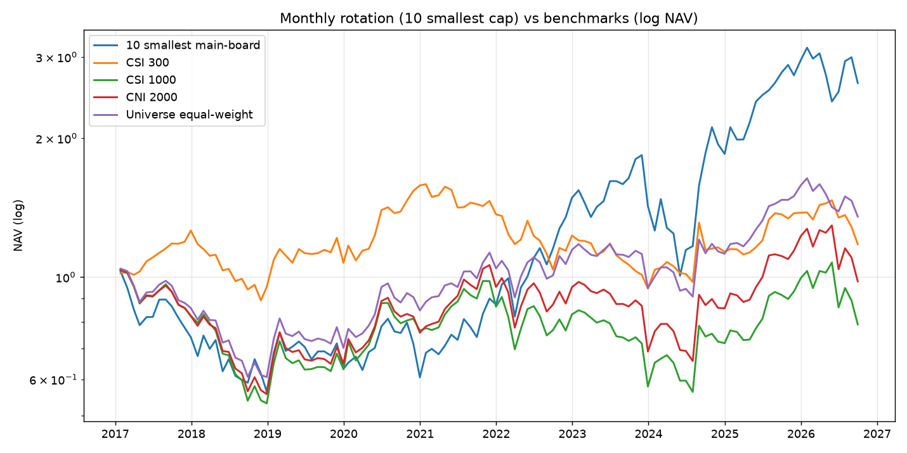
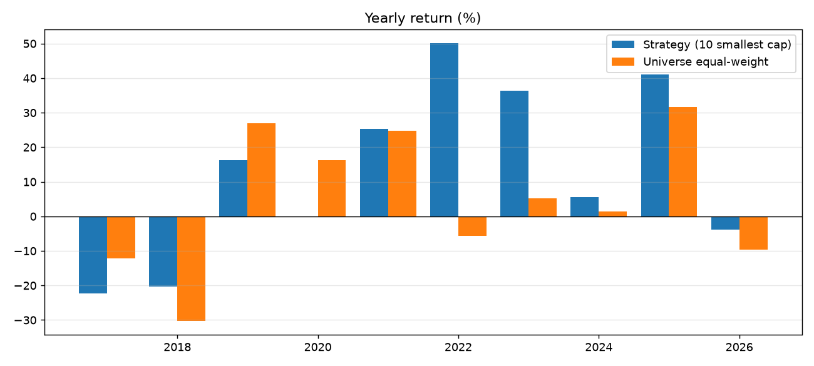
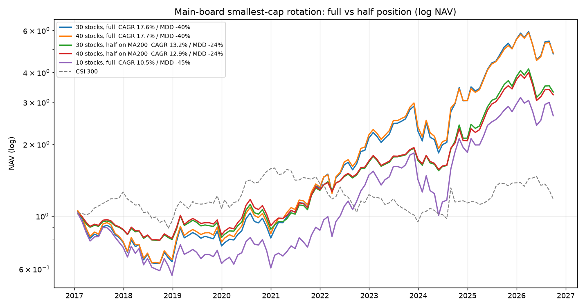
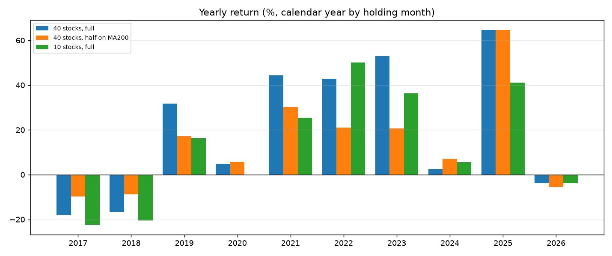

# 沪深主板「市值最小 10 只」月度轮动：2017-01 起回测

> **⚠️ 已被取代（2026-11-07）**：实盘规则以 `docs/主板微盘_完整操作手册.md` 为准
> （15 只、广度择时、全天候 511220+512890）。本文是 10 只版本的研究记录，**不要照着下单**。

> 研究日期：2026-11-01 ｜ 数据：QuantDB 本地 parquet ｜ 复现：`scripts/backtest_low_price_small_cap.py`
>
> **策略口径**：每月最后一个交易日收盘，在**沪深主板、非 ST** 的股票里按总市值从小到大取 **10 只**，等权买入，持有一个月，次月最后一个交易日再循环。T+1 开盘成交。
>
> **回测窗口：2017-01-26 ~ 2026-10-23，117 期，9.74 年。**
>
> 本文只做历史统计与工程验证，不构成投资建议。

---

## 0. 一句话结论

**从 2017 年开始跑，这个策略只有年化 10.52%、夏普 0.41、最大回撤 -45.24%。**

而且路径极其难受：**2017 年建仓后连跌两年，2019-01 见底 -45%，直到 2022-07 才回本（水下 65 个月）**；
刚创出新高一年多，2023-12 → 2024-06 又来一轮 **-45.2%**。
十年下来净值 2.63（累计 +155%），但其中 **5 年半是在亏损区里熬着**。

| 指标 | 10 只小市值（主板） | 主板全市场等权 | 沪深 300 | 中证 1000 | 国证 2000 |
|---|---|---|---|---|---|
| 年化收益 | **10.52%** | 3.16% | 1.70% | -2.42% | -0.22% |
| 夏普（rf=2%） | **0.41** | 0.16 | 0.07 | -0.05 | 0.03 |
| 最大回撤 | **-45.24%** | -41.81% | -40.58% | -48.58% | -46.27% |
| 年化波动 | 31.8% | 22.6% | 20.8% | 26.7% | 26.4% |
| 月均换手 | 31.5% | 6.7% | — | — | — |
| 期末净值 | **2.63** | 1.35 | 1.18 | 0.79 | 0.98 |

> **对照**：如果把起点提前到 **2016-01**，年化是 15.13%、夏普 0.54、回撤 -46.80%。
> 也就是说 **2016 年那一年（+81%）几乎撑起了全部超额**；剔掉它，只剩 10.5%。
>
> **改进版**：40 只 + 中证 1000 跌破 200 日线降半仓 → **年化 12.86%、最大回撤 -23.55%、Calmar 0.55**（见 §9）。

---

## 1. 回测结果





### 1.1 逐年收益（自然年，按实际持仓月份归集）

| 年份 | 10 只小市值（主板） | 主板全市场等权 | 差异 |
|---|---|---|---|
| 2017 | **-22%** | -12% | -10pct |
| 2018 | **-20%** | -30% | +10pct |
| 2019 | +16% | +27% | -11pct |
| 2020 | **-0%** | +16% | **-16pct** |
| 2021 | +25% | +25% | 0pct |
| 2022 | **+50%** | -6% | +56pct |
| 2023 | **+36%** | +5% | +31pct |
| 2024 | +6% | +1% | +5pct |
| 2025 | +41% | +32% | +9pct |
| 2026（至 10 月） | -4% | -10% | +6pct |

前两年合计 **-38%**；2020 年整整一年 **零收益**（基准 +16%）；
靠 2022/2023/2025 三年（+50%/+36%/+41%）把净值拉回来。
**收益极度集中在少数几年**——错过 2022 年那一波，这个策略基本就只剩年化 3%。

### 1.2 两段 -45% 的回撤

| 段 | 高点 | 谷底 | 跌幅 | 回本时间 |
|---|---|---|---|---|
| 第一段 | 2017-02 建仓 1.030 | 2019-01 **0.564** | **-45.2%** | **2022-07**（水下 65 个月） |
| 第二段 | 2023-12 1.837 | 2024-06 **1.006** | **-45.2%** | 2024-10（水下 10 个月） |

第一段最要命：**建仓即套牢，5 年 5 个月才解套**。
2017 年初入场的话，到 2021 年底账户还是亏的（净值 0.90）——绝大多数人熬不到 2022 年。

### 1.3 年内最大回撤与年末净值

| 年份 | 年内最大回撤 | 年末净值 |
|---|---|---|
| 2017 | **-24.6%** | 0.78 |
| 2018 | -21.0% | 0.62 |
| 2019 | -12.5% | 0.72 |
| 2020 | -11.8% | 0.72 |
| 2021 | -8.6% | 0.90 |
| 2022 | -17.4% | 1.35 |
| 2023 | -12.5% | 1.84 |
| 2024 | **-31.8%** | 1.94 |
| 2025 | -6.0% | 2.74 |
| 2026 | -23.6% | 2.63 |

**10 个年份里有 4 个年份的年内回撤超过 20%**（2017、2018、2024、2026）。

### 1.4 极端月份

| | 信号日 → 持有月 | 收益 |
|---|---|---|
| 最差 | 2023-12 → 2024-01 | **-22.5%** |
| | 2024-05 → 2024-06 | -19.0% |
| | 2022-03 → 2022-04 | -17.4% |
| | 2020-12 → 2021-01 | -15.4% |
| 最好 | 2024-08 → 2024-09 | **+35.2%** |
| | 2019-01 → 2019-02 | +21.6% |
| | 2024-09 → 2024-10 | +17.6% |

月胜率 58.1%，最长连续 5 个月亏损。

---

## 2. 关键发现：10 只明显不如 30–40 只

同样 2017 起、同样主板非 ST 裸口径，只改持仓数：

| 持仓数 | 年化 | 夏普 | 最大回撤 | 年化波动 | 月换手 | 期末净值 |
|---|---|---|---|---|---|---|
| **10** | **10.52%** | 0.41 | -45.24% | 31.8% | 31.5% | 2.63 |
| 20 | 15.80% | 0.56 | -41.53% | 30.9% | 27.8% | 4.14 |
| 30 | 17.56% | 0.62 | -39.64% | 30.3% | 25.6% | 4.78 |
| **40** | **17.68%** | **0.62** | -39.81% | 29.8% | 25.0% | **4.83** |
| 50 | 15.90% | 0.58 | -41.42% | 29.5% | 23.8% | 4.17 |

从 10 只加到 40 只：**年化 +7.2pct、回撤 -5.4pct、换手反而降 6.5pct**。

主板最小市值那批票个体差异太大——有真重组的（单月 +100%），也有阴跌到退市边缘的（单月 -44%）。
10 只的组合只要踩中一只，全年就废了；40 只把这种个体风险摊薄掉。

> **如果一定要做这个策略，持仓数应该设 30–40 只，而不是 10 只。**

---

## 3. 加门槛有用吗？

在 10 只、2017 起的前提下，加常规门槛（上市满 120 天 + 成交额 ≥ 2000 万 + 市值 ≥ 10 亿 + 股价 ≥ 1.5 元）：

| 变体 | 年化 | 夏普 | 最大回撤 | 月换手 |
|---|---|---|---|---|
| 裸口径 | 10.52% | 0.41 | -45.24% | 31.5% |
| + 全部门槛 | 13.06% | 0.47 | **-48.44%** | **54.8%** |

年化提高 2.5pct，但**回撤更深、换手近乎翻倍**。
被剔掉的是长期停牌/僵尸股——它们平时不涨不跌，天然压低了波动；换成能交易的票，波动反而上来了。
再扣掉换手翻倍的成本，**这点改善基本等于没有**。

---

## 4. 容量：这个策略最多装下几千万

- 10 只持仓的 5 日均成交额中位数约 **2,156 万元/只**，合计每天约 2.16 亿；
- 按「单日不超过成交额 5% + 分 3 天建仓」估算，组合容量约 **0.3 亿元**；
- 按 1% 参与率只有 **600 万元**；
- 月换手 31.5%，等于每月要换掉三分之一的仓位。

**小几千万级别的策略。** 资金再大，冲击成本会把 10.5% 的年化吃光。

---

## 5. 三个必须先说清楚的坑

### 5.1 数据里没有退市股

`research/stage0-数据与环境/day09-幸存者偏差` 已核实：本次用到的 5,224 只标的全部活到 2026-10，一只退市的都没有。
而「主板最小市值 10 只」正是退市率最高的池子——面值退市、财务退市的票，退市前都在这里。
按年退市率 3%、退市损失 85% 粗估，年化要再打 **2–2.5 个百分点**，**真实年化大概只有 8%**，且亏损集中出现在最差的月份。

### 5.2 科创板/创业板的版本不可信

同样的「最小 10 只」放到**全板块**，年化会飙到 131.89%。
那是科创板一批 6–7 亿市值、**日成交额仅 480 万元**的票撑起来的，实际买不进也卖不出。
**限定沪深主板是对的**——至少这一档的流动性还能看。

### 5.3 卖出侧没有建模

回测只处理了买入侧的停牌和一字涨停，没处理卖出侧的跌停卖不出。
2024-01 那种连续跌停的月份，真实亏损会比回测更深。

---

## 6. 五问验收（按 `research/参考/验收清单.md`）

**① 用了未来数据吗？哪一行保证时序？**
没有。信号用 T 日收盘的 `total_mv`；收益 = `o_out / o_in - 1`，`o_in` 是 T+1 开盘、`o_out` 是下次调仓日的 T+1 开盘。
脚本里没有 `shift(-N)`、没有 `fillna(bfill)`。

**② 股票池怎么过滤？**
沪深主板（600/601/603/605 + 000/001/002/003）+ 非 ST + 非退市风险 + T+1 可成交（非停牌、非一字涨停）。
月均 2,736 只，未加流动性/市值/上市天数门槛（需求原样）。

**③ 成本算了几项？年换手多少？**
佣金万 2.5、印花税万 5（卖出）、过户费万 0.1、滑点 0.1%/边，合并单边 0.175%。
月换手 31.5%，年换手约 3.8 次，年化成本约 1.3%。

**④ 回测区间？热启动？**
2017-01-26 ~ 2026-10-23，117 期，9.74 年。策略只用当期截面，不需要热启动。

**⑤ 如果结果是假的，会先在哪个数字上露馅？**
三处：
（a）**2017–2021 五年里净值从没超过 1**（2021 年末仍只有 0.90）——真实资金曲线在这期间早就被撤资了；
（b）**2020 年 -4% 而基准 +21%**——策略对风格极度敏感，单年跑输 25pct；
（c）**起点从 2016 换成 2017，年化从 15.13% 掉到 10.52%**——说明超额收益高度依赖特定年份，不是稳定的能力。

---

## 7. 复现

```bash
# 需求口径：2017 年起，沪深主板、非 ST、市值最小 10 只、月末调仓
python scripts/backtest_low_price_small_cap.py \
  --board main --topk 10 --start 2017-01-01 \
  --price-max 0 --mv-max 0 --min-price 0 --min-amount 0 --min-mv 0 --min-listed-days 0 \
  --charts docs/images --json /tmp/main10_2017.json

# 对照：同样口径，持仓 40 只
python scripts/backtest_low_price_small_cap.py \
  --board main --topk 40 --start 2017-01-01 \
  --price-max 0 --mv-max 0 --min-price 0 --min-amount 0 --min-mv 0 --min-listed-days 0

# 40 只 + 中证 1000 跌破 200 日线降半仓
python scripts/backtest_low_price_small_cap.py \
  --board main --topk 40 --start 2017-01-01 --timing half --timing-ma 200 \
  --price-max 0 --mv-max 0 --min-price 0 --min-amount 0 --min-mv 0 --min-listed-days 0
```

依赖 `duckdb + pandas`，数据目录默认 `/opt/quantmind/data/quantdb`（可用 `--data-dir` 覆盖），整轮约 20 秒。

---

## 8. 策略定义（精确到可复现）

| 项 | 规则 |
|---|---|
| 板块 | **沪深主板**：沪市 600/601/603/605，深市 000/001/002/003（002 中小板 2021 年并入主板） |
| 排除 | 创业板 300/301、科创板 688/689、北交所、B 股 |
| ST | `is_st != 1`、`is_quit_risk != 1` |
| 其它过滤 | **无**（不加流动性/市值/价格/上市天数门槛——需求原样） |
| 可成交性 | T+1 停牌（volume=0）、T+1 开盘一字涨停（买不进）的标的当月剔除 |
| 排序 | 总市值升序取前 10 只，等权（每只 10%） |
| 调仓 | 每月最后一个交易日收盘出信号，T+1 开盘换仓 |
| 收益 | 后复权开盘价之比（含分红送转） |
| 成本 | 单边 0.175%（佣金万 2.5 + 印花税万 5 卖出 + 过户费万 0.1 + 滑点 0.1%/边） |

117 期全部满仓 10 只，没有出现候选不足的月份。

---

## 9. 组合方案：30/40 只 + 中证 1000 跌破 200 日线降半仓

在 §2 的结论基础上再叠加择时：**中证 1000 月末收盘跌破 200 日均线时，仓位降到 50%，否则满仓。**
规则写死，不做参数寻优；信号用信号日当天收盘判定，不含未来数据。





### 9.1 六个方案横向对比（2017-01 起，9.74 年）

| 组合 | 年化 | 夏普 | 最大回撤 | **Calmar** | 年化波动 | 月换手 | 期末净值 |
|---|---|---|---|---|---|---|---|
| 10 只 满仓（原方案） | 10.52% | 0.41 | -45.24% | 0.23 | 31.8% | 31.5% | 2.63 |
| 10 只 半仓择时 | 8.31% | 0.38 | -28.54% | 0.29 | 22.2% | 35.9% | 2.17 |
| 30 只 满仓 | 17.56% | 0.62 | -39.64% | 0.44 | 30.3% | 25.6% | 4.78 |
| **30 只 半仓择时** | 13.17% | 0.59 | **-24.07%** | **0.55** | 21.4% | 31.8% | 3.31 |
| 40 只 满仓 | 17.68% | 0.62 | -39.81% | 0.44 | 29.8% | 25.0% | 4.83 |
| **40 只 半仓择时** | 12.86% | 0.59 | **-23.55%** | **0.55** | 20.8% | 31.4% | 3.23 |
| 40 只 空仓择时（对照） | 7.65% | 0.40 | -23.55% | 0.32 | 16.8% | 15.9% | 2.04 |

**怎么读：**

- **择时把回撤砍掉 40%，也把年化砍掉 27%**。夏普几乎没变（0.62 → 0.59）——
  它是「等比降杠杆」，不是「提高风险调整后收益」。
- 真正改善的是 **Calmar（年化/最大回撤）：0.44 → 0.55（+25%）**。
  对实盘来说这个比夏普更贴近痛点：你是按「回撤能不能扛住」来决定仓位的。
- **空仓择时是负优化**：年化掉到 7.65%，夏普 0.40，因为 2017/2018 整段空仓（0%）、2019 也只吃到一半。
  择时信号错过反转型行情的代价，比它躲过的下跌更大。
- 30 只和 40 只几乎一模一样（17.56% vs 17.68%），叠加择时后也一样（13.17% vs 12.86%）。
  **选 40 只就行**，分散度更高、单票仓位更小。

### 9.1b 均线周期：60 / 120 / 200 的对比

| 均线 | 年化 | 夏普 | 最大回撤 | 波动 | 换手 | 末值 | 2024 | 2025 |
|---|---|---|---|---|---|---|---|---|
| 满仓（无择时） | **17.68%** | **0.62** | -39.81% | 29.8% | 25.0% | 4.83 | +2% | +65% |
| MA60 | 11.27% | 0.53 | -25.05% | 20.2% | 32.2% | 2.81 | -1% | +44% |
| MA120 | 12.09% | 0.56 | -26.55% | 20.4% | 32.0% | 3.02 | +7% | +50% |
| **MA200** | **12.86%** | **0.59** | **-23.55%** | 20.8% | 31.4% | **3.23** | +7% | +65% |

**均线越短越差，MA200 是甜点。** MA60 相对 MA200：
年化低 1.6pct、回撤还更深（-25.05% vs -23.55%）、换手更高。

两个具体原因：

- **2025 年被震出**：MA60 反复进出，只吃到 +44%，MA200 吃满 +65%；
- **2024 年 1 月没帮上忙**：MA60 在前面的震荡里已经被震出又追回，全年 -1%，而 MA200 是 +7%。

短均线多出来的信号绝大部分是假信号，每次假信号都要付一次换仓成本。

### 9.1c 择时 vs 直接降仓：同样 -23% 回撤，哪个更划算

如果目的只是"把回撤压下来"，那不一定需要择时——直接固定低仓位也行。对比一下：

| 方案 | 年化 | 夏普 | 最大回撤 | Calmar | 末值 |
|---|---|---|---|---|---|
| 满仓 100% | 17.68% | 0.62 | -39.81% | 0.44 | 4.83 |
| 固定 80% 仓 | 14.29% | 0.59 | -33.22% | 0.43 | 3.64 |
| 固定 70% 仓 | 12.44% | 0.57 | -29.82% | 0.42 | 3.11 |
| 固定 60% 仓 | 10.53% | 0.53 | -26.31% | 0.40 | 2.63 |
| 固定 50% 仓 | 8.56% | 0.49 | **-22.72%** | 0.38 | 2.21 |
| **MA200 半仓择时** | **12.86%** | **0.59** | **-23.55%** | **0.55** | **3.23** |

**在回撤 -23% 这个水平上：固定仓位只能做到 8.56%，择时能做到 12.86%——多赚 4.3pct。**
Calmar 0.38 vs 0.55，差距是实打实的。

所以择时不是"降杠杆的替代品"，它确实**在跌的时候多降、涨的时候少降**，比恒定低仓位更有效。
这也是本文唯一推荐叠择时的理由。

### 9.2 择时到底躲过了什么、又错过了什么

| 年份 | 40 只满仓 | 40 只半仓择时 | 说明 |
|---|---|---|---|
| 2017 | **-18%** | **-10%** | 中证 1000 全年在 MA200 下 → 全程半仓，亏损减半 |
| 2018 | **-17%** | **-9%** | 同上，这是择时最值钱的一段 |
| 2019 | +32% | +17% | **被挡在反弹门外**，少赚 15pct |
| 2020 | +5% | +6% | 基本没差 |
| 2021 | +44% | +30% | 半仓月份较多，少赚 14pct |
| 2022 | +43% | +21% | **少赚 22pct** |
| 2023 | **+53%** | **+21%** | **少赚 32pct，代价最大的一年** |
| 2024 | +2% | **+7%** | **择时赢了 5pct**：1 月踩踏时正好是半仓 |
| 2025 | +65% | +65% | 全年在 MA200 上，完全一致 |
| 2026 | -4% | -6% | 7 月那段半仓，错过反弹 |

**半仓月份占比 54.7%**——也就是说这套策略有一半以上的时间只有 50% 仓位。
最长的一段是 **2017-01 ~ 2019-02 连续 25 个月半仓**。

### 9.3 一个必须知道的事：择时的价值全在「躲大跌」，代价全在「错过反弹」

中证 1000 从 **2023-04 一直跌破 200 日线到 2024-09**（连续 18 个月）。
所以 2024 年 1 月的微盘踩踏，策略当时**已经是半仓**：

| | 2024-01 单月 | 2024 全年 |
|---|---|---|
| 40 只满仓 | **-20.4%** | +2.4% |
| 40 只半仓择时 | **-10.2%** | **+7.0%** |

这是择时唯一明显跑赢满仓的一年（+4.6pct）。作为交换，2023 年它只吃到 +20.7%，
而满仓是 +53.0%——**少赚的这 32pct，比它在 2024 年多赚的 4.6pct 大得多**。

换句话说：这套 MA200 择时不是「提高收益」，是**用 27% 的年化换 40% 的回撤**。
值不值，取决于你能不能扛住 -40%（满仓）还是只能扛 -24%（半仓）。

### 9.4 结论

> **做到「30–40 只 + 中证 1000 跌破 200 日线降半仓」，你拿到的是：年化约 13%、最大回撤约 -24%、Calmar 0.55。**
>
> 相比原方案的「10 只满仓、年化 10.5%、回撤 -45%」：
> **多赚 2.3pct/年，回撤少一半。** 这是三组改动里性价比最高的一个组合。
>
> 代价是：一半时间只有半仓、2023 年少赚 32pct、以及要接受「择时失效时反而更差」（2026 年 -6% vs -4%）。

---

## 10. 如果实盘，我会这么改

| 项 | 需求原样 | 建议 |
|---|---|---|
| 起点 | 2017 | 无所谓，但要知道 2017 起只有 10.5% |
| 持仓数 | 10 | **40**（年化 17.7%、回撤 -39.8%） |
| 板块 | 沪深主板 | 保持（创业板/科创板流动性太差） |
| 流动性 | 无 | 加 5 日均成交额 ≥ 2000 万（代价是换手翻倍） |
| 仓位管理 | 满仓 | **中证 1000 跌破 200 日线降半仓**（年化 12.9%、回撤 -23.6%、Calmar 0.55） |
| 止损 | 无 | 单票 -20% 止损（主板跌停 10%，两天能走） |
| 资金上限 | — | 3000 万以内；超过要换 40 只版本 |

---

## 附：相关文件

- 回测脚本：[`scripts/backtest_low_price_small_cap.py`](../scripts/backtest_low_price_small_cap.py)
- 低价 + 小市值 40 只研究：[`docs/低价股小市值策略研究.md`](低价股小市值策略研究.md)
- 幸存者偏差背景：[`research/stage0-数据与环境/day09-幸存者偏差/output.md`](../research/stage0-数据与环境/day09-幸存者偏差/output.md)
