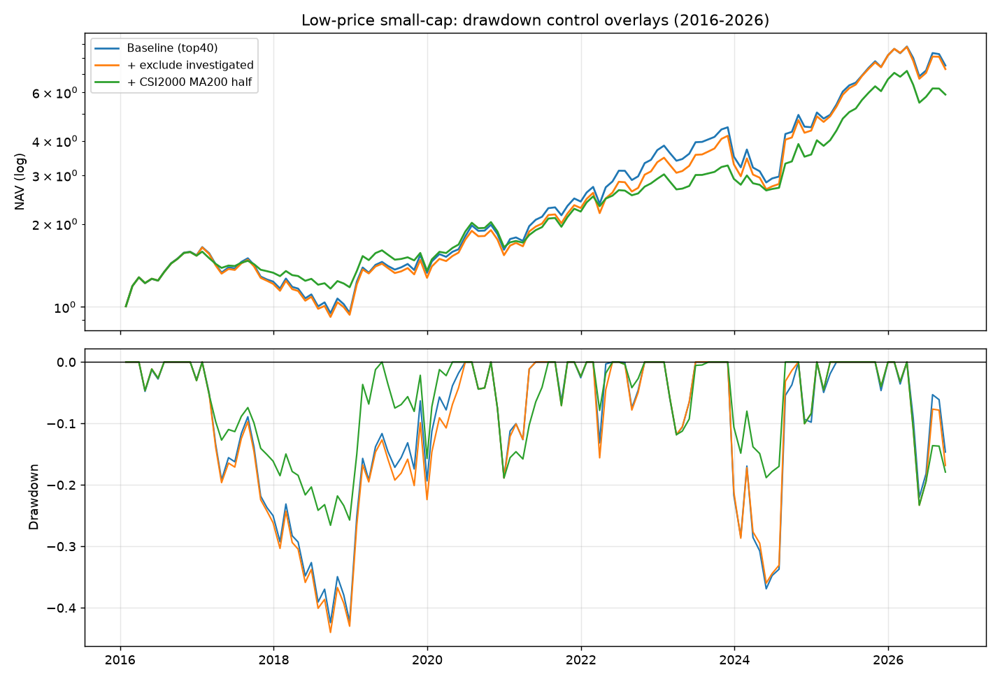

# 低价小市值：回撤控制实验（立案剔除 / 择时 / 对冲）

> 日期：2026-11-02 ｜ 数据：QuantDB parquet + 巨潮资讯公告 ｜ 复现：`scripts/research_lowprice_drawdown.py`
>
> 母文档：[低价股小市值策略研究](./低价股小市值策略研究.md)。本文只回答一个问题：
> **年化 20.8%、最大回撤 -42.4% 的策略，哪里能真正把回撤压下去？**
> 只做历史统计与工程验证，不构成投资建议。

---

## 0. 一句话结论

把回撤从 **-42.4% 压到 -23%～-25%** 是能做到的，但**不是靠选股**——靠的是仓位。
七条结论，按可靠度排序：

| # | 结论 | 证据 | 可靠度 |
|---|---|---|---|
| 1 | **回撤是微盘 beta，不是个股暴雷** | 对国证 2000 beta 0.89、R² 0.59；年化 alpha 18.8% | ★★★★★ |
| 2 | **只有仓位控制能大幅压回撤** | 中证 1000 MA200 半仓：-42.4% → **-23.4%**，Calmar 0.49 → 0.76 | ★★★★ |
| 3 | **剔除立案调查在组合层面近乎无效** | 20.8% → 20.5%，回撤反而 -44.0%；主板口径才略微转正 | ★★★★ |
| 4 | **股指对冲计入贴水后不划算** | 50% 对冲无贴水 20.1%，计 5% 贴水只剩 17.1% | ★★★★ |
| 5 | **微盘拥挤度抓得到 2024-01，但加了等于没加** | 14 个触发月**全部**落在 MA200 跌破的月份里（差集 0），零增量 | ★★★★ |
| 6 | **真实退市率约 4%，期望拖累 -3pp 且与只数无关** | top40 从 20.6% 掉到 **17.8%**；集中度只影响尾部宽度 | ★★★★ |
| 7 | **连续仓位不如二值开关** | 匹配平均仓位后 Calmar 0.72 → 0.54~0.56，四个参数一致 | ★★★ |
| 8 | **七种仓位优化尝试全部失败** | 反向/连续/拥挤度/弱动量/回踩再入场，跨指数检验均不复现（§5.9） | ★★★★ |

> **本文所有数字已在 2026-11-02 修复未来函数/账户核算后重跑**。
> 修复清单与前后对照见 [代码审查报告](./代码审查报告_低价小市值回测.md) §8。
> 修复前后主结论方向一致，具体数值略有变化（例如基准 -43.9% → -42.4%）。

外加一个必须修的**口径 bug**：母文档表 0 最初的 20.66% 是 `--board ex_star` 跑出来的，
而 §7 的复现命令走脚本默认 `main`，跑出来是 17.65%。见第 1 节。

---

## 1. 先修口径：`main` 和 `ex_star` 是两个策略

母文档 §1.1 写的股票池是「剔除科创板」（= `ex_star`），但 §7 的命令没带参数，
走的是脚本默认 `main`（**只沪深主板，不含创业板 300/301**）。同一个脚本，两个结果：

| 板块口径 | 月均股票池 | 年化 | 夏普 | 最大回撤 | 月换手 |
|---|---|---|---|---|---|
| `main`（仅主板，脚本默认） | 2,363 只 | 17.65% | 0.63 | -45.24% | 45.4% |
| **`ex_star`（主板+创业板，母文档表 0）** | **3,201 只** | **20.46%** | **0.70** | **-44.00%** | **44.9%** |
| `all`（再加科创板 222 只） | ~3,420 只 | — | — | — | — |

**3.5 个百分点的年化差，全在创业板那 830 只小票上**：创业板盘子更小、弹性更大，
所以收益更高、回撤反而略浅。这不是数据漂移，是口径差异——两套数字都对，但必须说清是哪套。

本文以下全部用 `ex_star`（与母文档表 0 一致），`main` 作为稳健性对照。
母文档 §7 的复现命令已补 `--board ex_star`。

---

## 2. 回撤归因：它到底在跌什么

把策略月度净收益对指数月度收益做回归（2016-01 ~ 2026-10，129 期）：

| 基准 | beta | 年化 alpha | R² |
|---|---|---|---|
| 中证 1000 | 0.82 | 21.3% | 0.51 |
| **国证 2000** | **0.89** | **18.8%** | **0.59** |
| 沪深 300 | 0.77 | 19.4% | 0.27 |

**R² 0.59 意味着六成波动直接是微盘指数给的。** 再看最大回撤的形状：

| 项 | 数值 |
|---|---|
| 回撤峰 → 谷 | 2017-01-26 → 2018-09-28（**20 个月**，-42.4%） |
| 修复日 | 2020-06-30（水下 **41 个月**） |
| 最差单月 | 2023-12-29 信号（即 2024-01）-21.7% |
| 次差 | 2026-05 -14.2%、2024-03 -14.0%、2019-12 -13.9%、2022-03 -13.2% |

三次重击（2017 监管杀壳、2018 去杠杆、2024-01 微盘踩踏）**没有一次是「选到一只雷股」**，
全部是系统性风险。这直接决定了干预手段的有效边界：

> 想靠「把坏公司剔出去」解决系统性问题，方向就错了。

---

## 3. 立案调查：数据、事件研究、组合效果

### 3.1 事件表（这次真的把它拉下来了）

母仓库原有一份[补数据方案](./数据补全_退市股与监管事件.md)，但 `data/regulatory/` **从未生成过**。
本次用**巨潮资讯全文检索**（关键词 `立案` / `调查通知书` / `退市风险警示`，按年切片翻页）
替代原来「按交易日翻全市场公告」的东财口径，**2.5 小时压到约 5 分钟**：

```bash
python scripts/fetch_regulatory_events.py --start 2016-01-01 --end 2026-11-02
```

产出 `data/regulatory/events.parquet`：

| 项 | 数值 |
|---|---|
| 事件总数 | 7,648 条 |
| 涉及标的 | 1,174 只 |
| 披露日 | 2,384 个交易日（2016-01-01 ~ 2026-11-02） |
| `investigation` 立案调查 | **3,365 条 / 865 只** |
| `delist_risk` 退市风险 | 4,272 条 |

完整性已校验：2016 年半年切片的条数之和（107+93）等于全年（200），不存在分页截断。
抽样核对：康美药业 2018-12-29、康得新 2018-10-29、奥联电子 2023-02-23，
与公告披露日一致。

### 3.2 事件研究：立案后一个月真的跌

对 979 个「立案公告披露后首个信号月」的样本，算相对同池等权的超额收益：

| 指标 | 数值 |
|---|---|
| 平均超额（主板口径） | **-0.74%/月**，t = **-2.16**，n = 989 |
| 平均超额（ex_star 口径） | -0.40%/月，t = -1.26，n = 1,261 |
| 中位 | -1.28% ~ -1.48% |
| 下跌概率 | 56%~58%（基准 50%） |
| 最差 5% | -16.4% |

> **口径影响很大**：主板里立案冲击显著（t=-2.16），加上创业板后变成不显著（t=-1.26）。
> 这本身就说明「剔除立案」的收益改善不可靠——见 §3.3。

方向对、显著、但**幅度不大**——一个月平均只输 0.75%。对比母文档引用的新闻口径
「T+5 平均 -2.67%」：公告口径的冲击更平缓，因为立案后往往有长期阴跌而非单日崩塌。

### 3.3 组合效果：几乎没有

| 变体 | 年化 | 夏普 | 最大回撤 | 最差月 | 2024 |
|---|---|---|---|---|---|
| ① 基准 top40 | 20.8% | 0.70 | -42.4% | -21.7% | +1% |
| ② 剔除立案（近 1 年） | 20.5% | 0.69 | -44.0% | -21.1% | +3% |
| ③ 剔除立案（近 2 年） | 20.1% | 0.68 | -43.5% | -21.1% | -0% |
| ④ 剔除立案（曾经） | 20.1% | 0.69 | -43.0% | -20.3% | -3% |
| ⑤ 剔除立案 + 退市风险（1 年） | 20.5% | 0.69 | -43.9% | -21.1% | +2% |

- 年化变化 **-0.3pp**，回撤反而**深了 1.6pp**；
- 换到 `main` 口径方向又翻正（17.20% → 17.65%），事件研究的 t 值也从 -1.26 变成 -2.16。
- **两个板块方向相反 ⇒ 这是噪声，不是稳定增益。**

**唯一稳定的好处在尾部**：最差月从 -21.7% 收窄到 -21.1%，2024 年从 -0% 变 +2%。
它降低的是「踩到雷」的概率，不是回撤的深度。

### 3.4 为什么没用——两个诚实的原因

1. **覆盖率太低**：近 1 年被立案的标的只占候选池 **3.0%**（最高 6.0%）。40 只里平均不到 1.3 只，
   剔掉它对组合路径的影响本来就小。
2. **幸存者偏差把真凶藏起来了**：数据里**没有退市股**。而「立案 → 面值退市 → 跌 90%」这条链
   最凶的样本（正是低价小市值这个池子）根本不在面板里。所以 3.2 的 -0.75% 和 3.3 的「没效果」
   **都是低估**——真实世界里这条过滤的价值应该高于回测显示。

> 结论：**该用，但别指望它救回撤**。它的定位是「不出事」而不是「少波动」。
> 已作为主回测脚本的默认项（`--no-exclude-investigation` 可关）。

---

## 4. 因子研究：先看它会不会在坏月份里失效

### 4.1 方法：三轮筛选，缺一不可

单看全样本 IC 会骗人。一个因子可以在 80% 的月份里稳定赚钱，然后在剩下的月份里
把前面赚的全吐回去——这正是我们要防的。所以每个因子过三道关：

```
第一轮  截面 IC（月末秩相关）           → 有没有信息
第二轮  坏月份 IC（池子最差 25% 的月份）  → 崩盘时还灵不灵（关键）
第三轮  十分位多空（D1 最高分位 - D10）  → 能不能做成组合
```

第二轮是重点：**一个因子如果在坏月份 IC 变号，它就是「平时赚钱、崩盘加倍亏」的陷阱。**

### 4.2 实测（低价小市值候选池，567 只/月，129 期）

| 因子 | 全样本 IC | ICIR | **坏月份 IC** | 坏月份十分位多空 | 全样本多空 |
|---|---|---|---|---|---|
| 低波（-vol_20） | 0.094 | 0.61 | **+0.172** | **+3.25%** | +1.34% |
| 账面市值比 BP | 0.049 | 0.42 | +0.109 | +2.22% | +0.85% |
| 盈利收益率 EP | 0.033 | 0.31 | +0.112 | +1.92% | +0.36% |
| 换手率 | 0.051 | 0.36 | **-0.058** | +1.54% | **+4.18%** |
| 低 beta | 0.007 | 0.07 | +0.043 | +0.91% | -0.36% |
| RSI(14) | -0.068 | -0.44 | -0.026 | +0.39% | -1.55% |
| 偏离 MA20 | -0.067 | -0.48 | -0.019 | -0.21% | -1.93% |
| 上月收益 | -0.076 | -0.50 | -0.042 | -0.52% | -2.13% |
| PS(TTM) | -0.029 | -0.30 | -0.074 | -1.59% | -0.58% |

注：IC 符号已统一成「因子值越大越好」；`-vol` 表示低波为正。

**读法（三条，都很反直觉）：**

1. **低波是坏月份里最强的保护**：全样本 IC 0.094 → 坏月份 0.171，几乎翻倍。
   跌的时候，低波小票确实更抗跌。
2. **高换手是「平时最好、崩盘最差」**：全样本多空 +4.29%（全表最高），
   但坏月份 IC 转负（-0.058）。高换手=拥挤，**平时给你 alpha，崩盘时加倍还回去**。
   这是个股层面的拥挤度。
3. **反转（上月收益）是最强的负向因子**：上月涨得多的下月跌（IC -0.074）。
   所以「剔除近月暴跌的票」是**自杀式**操作——见 5.1 表⑨，年化直接从 20.7% 掉到 **-1.8%**。

### 4.3 警告：IC 好 ≠ 组合好

按上面的表，低波 IC 最漂亮。但真做成组合（在最小 120 只里挑 40 只最低波）：

| 变体 | 年化 | 最大回撤 |
|---|---|---|
| 基准 | 20.8% | -42.4% |
| 最小 120 只里选低波 | **17.6%** | **-45.5%** |

**IC 正、组合反而更差。** 原因：IC 是截面平均关系，而组合只吃最小市值那一小段尾部；
在那一段里，低波往往等于「没人炒的壳」，2018 年这批票跌了 -30%（基准 -20%）。
**因子体检只能筛掉明显无效的，不能直接推出组合解。**

---

## 5. 干预手段的效费比（全部在 ex_star 口径，含成本）

### 5.1 总表：按 Calmar 排序

| 手段 | 年化 | 夏普 | 最大回撤 | **Calmar** | 评价 |
|---|---|---|---|---|---|
| ① 基准 top40 | 20.8% | 0.70 | -42.4% | 0.49 | — |
| 中证1000 MA200 半仓 | 17.7% | 0.78 | -23.4% | **0.76** | 回撤最小、Calmar 最高 |
| 国证2000 MA200 半仓 | 18.3% | 0.79 | -25.4% | **0.72** | 收益略高，回撤略深 |
| 拥挤度 ≥90% 空仓 | 21.5% | 0.87 | -29.9% | **0.72** | ⚠️ 与 MA200 完全重叠，零增量，见 5.4 |
| 中证1000 MA250 半仓 | 16.9% | 0.75 | -23.4% | 0.72 | |
| 相对强度破 6 月均线半仓 | 20.1% | 0.79 | -28.8% | 0.70 | 无阈值，较稳 |
| 立案剔除 + 国证2000 MA200 | 18.1% | 0.78 | -26.6% | 0.68 | 立案几乎不改结果 |
| 对冲 国证2000 50% | 20.1% | 0.86 | -29.4% | 0.68 | 无贴水假设，不实际 |
| 国证2000 MA200 空仓 | 14.2% | 0.72 | -22.0% | 0.65 | |
| 拥挤度 ≥90% 半仓 | 21.6% | 0.83 | -36.3% | 0.60 | ⚠️ 同上，冗余 |
| 国证2000 MA250 半仓 | 17.4% | 0.76 | -28.9% | 0.60 | |
| 中证1000 MA200 空仓 | 13.0% | 0.67 | -22.0% | 0.59 | |
| 拥挤度 ≥80% 半仓 | 18.9% | 0.75 | -33.2% | 0.57 | 阈值一挪就变差 |
| 中证1000 MA120 半仓 | 16.5% | 0.74 | -29.2% | 0.57 | |
| topk=20 | 24.7% | 0.79 | -44.2% | 0.56 | 提收益不提回撤 |
| 国证2000 MA120 半仓 | 16.8% | 0.74 | -31.1% | 0.54 | |
| 拥挤度 ≥95% 半仓 | 20.6% | 0.75 | -38.6% | 0.53 | 没躲过 2024-01（-17%） |
| 行业上限 4 只 | 20.8% | 0.71 | -42.6% | 0.49 | 无效（行业本来就不集中） |
| 股价下限 3 元 | 20.5% | 0.70 | -43.0% | 0.48 | 无效 |
| 立案剔除（曾经） | 20.1% | 0.69 | -43.0% | 0.47 | 近乎无效 |
| 剔除立案（近 1 年） | 20.5% | 0.69 | -44.0% | 0.46 | 近乎无效 |
| topk=80 | 19.7% | 0.68 | -44.3% | 0.45 | |
| 市值下限 15 亿 | 19.4% | 0.66 | -45.5% | 0.43 | 反而更差 |
| 波动率目标 25% | 18.4% | 0.67 | -42.4% | 0.43 | **无效**（波动率在崩盘后才上升） |
| 最小 120 只里选低波 | 17.6% | 0.64 | -45.5% | 0.39 | IC 好但组合差 |
| 剔除亏损 | 10.7% | 0.43 | -43.0% | 0.25 | 摧毁策略（低价小盘多为亏损股） |
| 剔除近月暴跌 | -1.6% | 0.02 | -69.3% | -0.02 | 自杀（删掉了反转收益） |

**三类手段的结论：**

- **仓位类（择时/对冲）**：唯一能实质性压回撤的，Calmar 0.49 → 0.68~0.76；
  **拥挤度不在其中**——它和 MA200 完全重叠（差集 0，见 5.4），不能算独立手段；
- **选股类（质量/估值/低波/价格）**：要么无效，要么反噬。**没有一条选股规则能把 -44% 变成 -30%**；
- **参数类（topk/行业/下限）**：平坦，调不出回撤。

### 5.2 为什么「波动率目标」完全无效

教科书答案是用波动率目标控回撤。这里失败了（回撤几乎没变）：

| 变体 | 年化 | 最大回撤 |
|---|---|---|
| 波动率目标 25% | 18.4% | -42.4% |
| 基准 | 20.8% | -42.4% |

原因：**波动率是回撤的滞后指标**。2024-01 的踩踏在一个月内完成，等 12 个月滚动波动率
升上去，仓位降下来时已经是 2024-03，反弹也错过了。**对「流动性踩踏型」回撤，
滞后类风控天然无效**——必须用能提前反映拥挤的指标。

### 5.3 对冲：贴水吃掉一半收益

策略 beta 0.90，理论上对冲就能把回撤砍半。但 IM/IC 长期贴水（2022–2024 年化约 5%~8%），
这是对冲最容易被忽略的成本：

| 对冲方案 | 年化 | 最大回撤 | Calmar |
|---|---|---|---|
| 国证2000 50%（无贴水） | 20.1% | -29.4% | 0.68 |
| 国证2000 50%（贴水 5%） | 17.1% | -30.3% | 0.56 |
| 国证2000 50%（贴水 8%） | 15.4% | -30.9% | 0.50 |
| 国证2000 100%（贴水 5%） | 11.9% | -28.8% | 0.41 |
| 中证1000 100%（贴水 8%） | 11.0% | -31.3% | 0.35 |

**计 5% 贴水后，50% 对冲（Calmar 0.56）就不如直接降仓（0.72）。**
对冲的价值在「不想错过反弹、又要压 beta」的场景，不在省事。

### 5.4 微盘拥挤度：抓得到 2024-01，但加了等于没加

**指标**：小市值组（≤50 亿）成交额占全市场比重，取历史扩张分位（至少 24 期）。

2023-12-29 那天占比 **21.1%**，处于 **94.5% 分位**——微盘极度拥挤，一个月后踩踏。
单看指标，它确实抓到了 2024-01 的前兆。

**单独用它做择时：**

| 规则 | 年化 | 最大回撤 | Calmar | 最差月 | 2024 |
|---|---|---|---|---|---|
| 不择时 | 20.8% | -42.4% | 0.49 | -21.7% | +1% |
| 占比 ≥85% 分位 → 半仓 | 20.1% | -36.0% | 0.56 | -14.2% | +5% |
| 占比 ≥90% 分位 → 半仓 | 21.4% | -37.9% | 0.57 | -14.2% | +6% |
| 占比 ≥90% 分位 → 空仓 | 21.5% | -29.9% | 0.72 | -14.2% | +3% |
| 占比 ≥95% 分位 → 半仓 | 20.1% | -38.6% | 0.52 | **-21.7%** | **-17%** |

看起来不错。**但它和 MA200 完全重叠，加进去是零增量。**

### 关键证据：拥挤度 ⊂ MA200

| 项 | 月份数 |
|---|---|
| 成交占比 ≥90% 分位触发的月份 | 14 |
| MA200 跌破的月份 | 60 |
| **两者交集** | **14** |
| **只在成交占比触发、MA200 未跌破** | **0** |

**14 个触发月全部落在 MA200 已经跌破的 60 个月里，差集为零。** 组合验证也印证：

| 组合方式 | 年化 | 回撤 | Calmar | 结论 |
|---|---|---|---|---|
| MA200 单独 | 18.3% | -25.4% | 0.72 | — |
| 占比≥90% **或** MA200 | 18.3% | -25.4% | **0.72** | 与 MA200 单独完全一致 |
| 占比≥90% **且** MA200 | 21.4% | -37.9% | 0.57 | 与占比单独完全一致 |
| 两者任一 → **1/4 仓** | 16.4% | -22.0% | 0.75 | 只提升 0.03 Calmar，代价 -1.9pp |

「或」等于 MA200、「且」等于占比——说明两者**从不独立触发**，拥挤度提供不了新信息。

**为什么？** 2024-01 不是"突然发生的踩踏"，是 2023 年年中就开始的下跌的末端。
MA200 在 **2023-07 就已跌破并一直保持半仓**。等到 2023-12 拥挤度飙到 94.5%，
你已经在半仓里待了半年。**拥挤度是趋势跌破的滞后确认，不是提前预警。**

### 阈值照样卡在刀尖上

2023-12 的分位是 **94.5%**：设 90% 能躲过（2024 年 +6%），设 95% 刚好错过（2024 年 **-17%**）。
**0.5 个百分点决定成败**，这是过拟合指纹，不是稳健证据。

### 一个看着更好、但不能信的变体

顺手测了「3 个月弱动量就减仓」，结果很亮眼：

```
年化 24.4%（比不择时的 20.8% 高）
2024 年 +25%
```

但它只触发 **6 次**，且其中 2 次正好是样本里最惨的月份：

| 触发月 | 池子当月收益 |
|---|---|
| 2018-05 | -12.2% |
| **2023-12** | **-18.7%** |
| 2024-01 | +0.6% |
| 2024-05 | -10.4% |
| 2026-05 | -10.7% |
| 2026-06 | +4.7% |

6 个数据点决定 3.6pp 年化提升，这是**事后挑选**不是规律。
而且它与因子研究矛盾：上月收益 IC 是 **-0.076**（反转），意味着跌完该涨；
这条规则是"跌完就跑"，方向反了，只是恰好踩中 2024-01 那次例外。

> **结论：拥挤度不要做择时信号。** 它零增量、阈值敏感、与 MA200 重叠。
>
> **正确的用法**是当"加仓窗口"的参考：分位 ≥90% 时**不要投新钱**（此时 MA200 通常也已跌破），
> 而不是拿它去决定已有仓位。
>
> **它覆盖不了的风险**：指数还在 MA200 上方时突发流动性事件（大产品强平）。
> 这次样本里没发生过。这类尾部风险只能靠**控总仓位**，没有信号能提前预警。

### 5.5 5 万本金买得了 40 只吗（实盘可行性）

**能买，但买不满。** 硬约束不是佣金，是**整手（100 股）**。

按最新一期（2026-09-30）真实股价算，5 万本金的实际投入：

| 方案 | 预算/只 | 实际/只 | **投入率** | 白留现金 | 手数分布 |
|---|---|---|---|---|---|
| top10 | 5,000 | 4,779 | **96%** | 2,213 | 5~10 手 |
| **top20** | 2,500 | **2,169** | **87%** | 6,620 | 2~8 手 |
| top40 | 1,250 | 941 | **75%** | 12,351 | 1~5 手 |

- 中位股价 6.51 元 → 1 手 651 元，**2 手要 1,302 元 > 1,250 预算**，所以 top40 里 23 只只能买 1 手；
- 整手取整平均每只浪费半手（约 300~450 元），40 只加起来就是 25% 的钱进不去。

整手约束下的实测（本金 5 万，佣金万 0.875 **免 5**，单一账本）：

| 方案 | 年化 | 最大回撤 | Calmar | 投入比例 | 月均费用 | 月均笔数 |
|---|---|---|---|---|---|---|
| 理想 40 只（不计整手） | 20.8% | -42.4% | 0.49 | 100% | — | — |
| **top40（整手实盘）** | 20.0% | -34.9% | 0.57 | 86% | 0.10% | 40 |
| top20 | 25.5% | -39.1% | 0.65 | 93% | 0.13% | 24 |
| top15 | 23.9% | -39.4% | 0.61 | 95% | 0.13% | 19 |
| **top10** | **27.3%** | -39.2% | 0.70 | 97% | 0.14% | 13 |

**读法：**

1. **免 5 之后佣金不是问题**：月均费用 0.10%~0.14%，年化 1.2%~1.7%，
   和模型里假设的 1.9% 同一量级。
   （若按「万 2.5 + 最低 5 元」算，5 万做 40 只光是佣金就要吃掉 5%~8%/年。）
2. **真正的代价是整手造成的现金拖累**：最新一期 25%~13% 的钱买不进去；
   但这是**时点数据**，10 年平均投入率是 86%（top40）~97%（top10），因为早年股价更低。
3. **5 万更适合 10~20 只**：每只 2,500~5,000 元，能买满整手，年化反而更高。
4. **手工执行成本**：top40 月均 40 笔，top10 只有 13 笔。

**集中度扫描**（5 万本金；理想 = 不计整手）：

| topk | 理想年化 | 理想回撤 | 实盘年化 | 实盘回撤 | 投入 | 月笔数 |
|---|---|---|---|---|---|---|
| 10 | 25.8% | -39.5% | 27.3% | -39.2% | 97% | 13 |
| 15 | 22.6% | -43.5% | 23.9% | -39.4% | 95% | 19 |
| 20 | 24.7% | -44.2% | 25.5% | -39.1% | 93% | 24 |
| 30 | 23.2% | -41.8% | 23.0% | -35.2% | 90% | 33 |
| 40 | 20.8% | -42.4% | 20.0% | -34.9% | 86% | 40 |
| 60 | 19.8% | -42.9% | 18.5% | -32.8% | 81% | 53 |
| 80 | 19.7% | -44.3% | 17.2% | -30.8% | 71% | 58 |

**越集中越高**（top10 25.8% vs top40 20.8%）。但 top15（22.6%）比 top20（24.7%）还低 2.1pp，
这个凹陷说明 **k 越小越不稳定**——不要因为 top10 跑到 27% 就上 top10，那是挑到运气好的 k。

**本金规模扫描**（top40 整手约束）：本金多大，整手拖累才消失

| 本金 | 年化 | 最大回撤 | Calmar | 投入比例 | 月均笔数 |
|---|---|---|---|---|---|
| 5 万 | 20.0% | -34.9% | 0.57 | 86% | 40 |
| 10 万 | 21.3% | -38.1% | 0.56 | 93% | 44 |
| **20 万** | **22.0%** | -39.7% | 0.55 | **97%** | 48 |
| **30 万** | **22.1%** | -40.5% | 0.54 | **98%** | 50 |
| 50 万 | 22.2% | -41.1% | 0.54 | 99% | 52 |
| 100 万 | 22.3% | -41.6% | 0.53 | 99% | 54 |
| 500 万 | 22.3% | -41.9% | 0.53 | 100% | 56 |

**拐点在 20~30 万**：每只 5,000 元时，6 元多的票能买 7~8 手，取整误差 <3%，投入率 97%~98%；
30 万以后年化封顶在 22.1%，再加钱只增加容量风险。

反过来说，**5 万的 86% 投入其实是半个免费风控**：少投的 14% 现金把回撤从 -42.4% 压到 -34.9%，
收益只少 0.8pp，Calmar 反而从 0.49 升到 0.57。

> 建议：**5 万 → top20**（87% 投入、24 笔/月、Calmar 0.65）；
> **想买满 40 只 → 20~30 万**（97%~98% 投入）。
> 复现：`python scripts/research_lowprice_drawdown.py --mode capital --capital 50000`

### 5.6 幸存者偏差压力测试：真实退市率下会掉多少

数据里 0 只退市股，而低价小票是退市率最高的一档。压力测试注入退市冲击，看两个问题：
**期望会掉多少**、**尾部有多宽**。

参数改为**直接指定持仓标的的年退市率**（不再按市值分位加权——top-k 天然全在最危险那一档，
再加分位权重只是伪精确）。

**先校准真实退市率**（用仓库 D09 的退市统计反推）：

| 层 | 年退市率 | 算法 |
|---|---|---|
| 全主板 | 0.84% | 210 只 ÷ 10.8 年 ÷ 2,324 只 |
| 2024 峰值年 | 1.9% | 46 只 ÷ 2,400 |
| **我们持仓（最小 40 只）** | **3%~5%** | 退市高度集中在低价小市值，按 75% 落在最小 20% 估算 |
| 2024 那种年份 | 7% | 同上，用峰值年 |

测四档：2%（乐观）、3%、**4%（基准假设）**、5%（悲观）。

**结果（单次退市当月损失 -60%，120 条路径）**：

| 持仓年退市率 | topk | 基准年化 | 注入后均值 | 5% 分位 | **均值-分位** | 注入后回撤 |
|---|---|---|---|---|---|---|
| 2% | 10 | 25.6% | 24.1% | 22.1% | 2.0pp | -41.0% |
| 2% | 20 | 24.5% | 23.1% | 21.6% | 1.5pp | -45.5% |
| 2% | 40 | 20.6% | 19.2% | 18.3% | 0.9pp | -43.6% |
| 3% | 10 | 25.6% | 23.3% | 20.9% | 2.4pp | -41.9% |
| 3% | 20 | 24.5% | 22.3% | 20.8% | 1.5pp | -46.0% |
| 3% | 40 | 20.6% | 18.5% | 17.6% | 0.9pp | -44.2% |
| **4%** | **10** | 25.6% | **22.6%** | **19.9%** | **2.7pp** | -42.8% |
| **4%** | **20** | 24.5% | **21.5%** | **19.7%** | **1.8pp** | -46.7% |
| **4%** | **40** | 20.6% | **17.8%** | **16.4%** | **1.4pp** | -44.9% |
| 5% | 10 | 25.6% | 21.9% | 18.8% | 3.1pp | -43.5% |
| 5% | 20 | 24.5% | 20.8% | 18.7% | 2.1pp | -47.5% |
| 5% | 40 | 20.6% | 17.1% | 15.6% | 1.5pp | -45.5% |

**三个结论：**

1. **期望拖累与只数无关，约为 -3pp**（4% 假设下：25.6→22.6、24.5→21.5、20.6→17.8，都是 -2.8~-3.0pp）。
   原因是一次冲击 ÷ N、被抽中概率 ∝ N，正好抵消——这是数学，不是模型细节。
   **top40 的真实预期就是 17.8% 左右**，和母文档「20.7% 要按 17%~19% 来预期」吻合。

2. **尾部随集中度变宽**：2.7pp（top10）→ 1.8pp（top20）→ 1.4pp（top40）。
   单次退市对净值的冲击是 -6%（10 只）/ -3%（20 只）/ -1.5%（40 只）。

3. **⚠️ 一个与我之前说法相反的结果**：4% 假设下，top10 的 5% 分位是 **19.9%**，和 top20 的 **19.7%**
   几乎一样。因为 top10 均值更高（22.6% vs 21.5%），正好抵消了它更宽的尾部。
   **所以「必须用 top20 而不是 top10」在真实退市率下站不住脚**——两者坏情形相当。
   top20 的优势只剩下「路径更可预测」，top10 的优势是「均值更高但方差更大」。

> 注意：`p_hold` 与 `-60%` 是假设输入，不是从真实退市样本估的。
> 用途是**比较不同 topk 对退市的敏感度**，不是给出"校正后年化"。

### 5.7 均线周期该用 60 / 100 还是 200

把 MA 周期从 20 扫到 250（国证 2000、半仓规则、top40 理想口径）：

| MA | 平均仓位 | 切换次数 | 年化 | 最大回撤 | **Calmar** | 2024 |
|---|---|---|---|---|---|---|
| 不择时 | 100% | 0 | 20.8% | -42.4% | 0.49 | +1% |
| 20 | 74% | **66** | 19.5% | -29.6% | 0.66 | +33% |
| 40 | 73% | 51 | 17.2% | -29.0% | 0.60 | -3% |
| 60 | 73% | 39 | 16.6% | -27.2% | 0.61 | -3% |
| 80 | 72% | 31 | 15.4% | -28.1% | 0.55 | -0% |
| 100 | 74% | 23 | 17.8% | -28.1% | 0.63 | +7% |
| 120 | 74% | 23 | 16.8% | -31.1% | 0.54 | +7% |
| 150 | 76% | 27 | 17.8% | -27.6% | 0.64 | +7% |
| **200** | 77% | 21 | **18.3%** | **-25.4%** | **0.72** | +7% |
| 250 | 78% | 17 | 17.4% | -28.9% | 0.60 | +7% |

**短均线没有更好**：MA60 年化比 MA200 少 1.7pp、回撤还深 1.8pp，切换次数却是 2 倍。
而且 80 比 100 差、120 比 150 差——**这个区间的差异大半是噪声**。

**但 MA20 看起来最好（Calmar 0.66、2024 年 +33%）——这是陷阱。** 分段检验：

| MA | 2016-2021 年化 | Calmar | 2021-2026 年化 | Calmar |
|---|---|---|---|---|
| 不择时 | 16.0% | 0.38 | 27.5% | 0.75 |
| **20** | **11.7%** | **0.39** | **30.7%** | **1.87** |
| 60 | 17.4% | 0.64 | 15.9% | 0.59 |
| **100** | **17.8%** | **0.63** | **18.0%** | **0.79** |
| 150 | 16.3% | 0.59 | 20.0% | 0.88 |
| 200 | 15.2% | 0.60 | 22.6% | 1.03 |
| 250 | 13.8% | 0.48 | 22.4% | 1.02 |

**三条读法：**

1. **MA20 是"牛市放大器"**：2021-2026 那波趋势里 Calmar 1.87，但 2016-2021 的震荡市只有 0.39
   （比不择时还差），66 次切换把它们磨掉了。**样本前后差异巨大，不能当作可复现的规则。**

2. **MA200 的优势也主要来自后半段**（0.60 → 1.03）。前半段它和 MA100 差不多。

3. **MA100 是唯一两个子区间都稳定的**：年化 17.8% / 18.0%、Calmar 0.63 / 0.79，几乎不受区间影响。

**结论：**

- **不要用 60 或更短**：收益更低、回撤没更小、切换翻倍；
- **MA100 是最"可复现"的选择**（样本内外一致），全样本 Calmar 0.63 略低于 200 的 0.72；
- **MA200 全样本最优，但它的边际优势集中在最近 5 年**，如果那段行情不可重演，实际表现会更接近 MA100；
- 实操上 100~200 之间怎么选差别不大（Calmar 0.54~0.72 的噪声带），**别去拟合那个峰值**。

> 我的建议：**用 150 或 200**（少切换、少打脸），或者接受"更稳但略低"用 100。
> 不要因为回测里 20 日最好就改用 20 日——它只是恰好踩中了 2021 年后的单边行情。

---

### 5.8 连续仓位 vs 二值开关：平滑反而更差

二值规则（MA200 上方满仓 / 下方半仓）有个缺点：在均线附近会来回打脸。
自然的想法是改成**连续仓位**：

```
exposure = clip(mid + slope × (指数收盘/MA200 - 1), 0.25, 1.0)
```

指数在均线附近时仓位平滑过渡，不再跳变。

**但这里的比较有个陷阱**：连续仓位的平均仓位天然更低，
回撤小只是"仓位低"而不是"规则好"。必须先**匹配平均仓位**再比。

匹配到 75%~76%（与二值规则同口径）后的结果：

| 方案 | 平均仓位 | 年化 | 夏普 | 最大回撤 | **Calmar** | 2018 | 2024 |
|---|---|---|---|---|---|---|---|
| **二值 MA200 半仓** | **75%** | **18.3%** | **0.79** | **-25.4%** | **0.72** | -9% | +7% |
| 连续 中0.75/斜1.0 | 76% | 17.2% | 0.74 | -31.6% | 0.54 | -13% | +2% |
| 连续 中0.75/斜1.5 | 76% | 17.1% | 0.75 | -30.9% | 0.55 | -13% | +1% |
| 连续 中0.75/斜2.0 | 75% | 16.8% | 0.75 | -30.3% | 0.56 | -12% | +0% |
| 连续 中0.8/斜3.0 | 76% | 16.5% | 0.73 | -29.6% | 0.56 | -11% | -3% |

**四个参数一致地更差**：年化少 1~1.8pp、回撤深 5~6pp、Calmar 0.72 → 0.54~0.56。

**为什么平滑反而更差？** 因为回撤是**前置**的：

- 指数刚跌 5%（dev=-5%）时，二值规则已经降到 0.5，连续规则的 mid=0.75 才降到 **0.68**——
  **下跌初期它还是重仓**，而这正是亏得最快的一段；
- 指数跌到 -40% 时，连续规则降到 0.25，比二值的 0.5 更低——可**那是底部，少持有没有意义**。

所以连续仓位在两个关键点上都是错的：**该砍的时候砍得慢，该加的时候加得慢**。
二值规则的"粗暴"恰恰是它的优势。

> 不排除其他参数化（如以 0 为中心的对称斜坡）会更好，但四个变体方向一致，
> 且机制解释清楚，我倾向认为这是结构性结论而不是参数没调好。

---

### 5.9 反向择时与回踩再入场：全部证伪

前面 5.1~5.8 验证的都是"趋势跟随"类的仓位规则。这一节记录**反方向**和三组变体，
因为它们是交易者最容易想到的方向，且**七个变体没有一个在跨指数检验下站得住**。

#### 5.9.1 反向 MA200：跌破满仓、站上半仓

逻辑直觉：微盘跌完会反弹（个股层面确实如此，上月收益 IC = -0.076）。

| 方案 | 平均仓位 | 年化 | 最大回撤 | Calmar | 2017 | 2018 | 2024 |
|---|---|---|---|---|---|---|---|
| 不择时 | 100% | 20.8% | -42.4% | 0.49 | -21% | -19% | +1% |
| **正向：跌破→半仓** | 77% | **18.3%** | **-25.4%** | **0.72** | -14% | -9% | +7% |
| 反向：跌破→满仓 / 站上→半仓 | 73% | 13.3% | -41.0% | 0.32 | -18% | -19% | -2% |
| 反向：跌破→满仓 / 站上→空仓 | 47% | 5.4% | -39.5% | 0.14 | -14% | -19% | -6% |
| 反向温和：站上→0.75 仓 | 87% | 17.1% | -41.7% | 0.41 | -19% | -19% | -1% |

**决定性对比**：反向版平均仓位 73%、回撤 -41.0%；正向版 77%、回撤 -25.4%。
仓位几乎一样，回撤差 16pp——**不是仓位差异，是方向错了**。
反向版在 2017、2018 毫无保护（-18% / -19%，与不择时相同）。

#### 5.9.2 为什么"买跌"在个股对、在指数错

这是我们整轮研究里最值得记住的一条：

| 层面 | 规律 | 证据 |
|---|---|---|
| **横截面**（同一天，股票之间比） | **反转**：跌得多的票接下来涨 | 上月收益 IC = **-0.076**；"剔除近月暴跌"→ 年化 **-1.6%** |
| **时序**（同一指数，时间上比） | **动量**：跌破均线后继续跌 | 反向规则回撤 **-41%** |

两者不矛盾，是不同维度：个股下跌多为情绪错杀、会被修复；整个指数跌破 MA200 是**系统性资金撤离**
（2017 杀壳、2018 去杠杆，一撤 20 个月），中途每次反弹都是离场机会而非入场机会。

> 所以策略本身已经在个股层面吃反转（选最小市值 = 选最被冷落的那批），
> 再叠加指数层面的反转，等于**在下跌趋势里加杠杆**。

#### 5.9.3 拥挤度反向：同样不成立

| 方案 | 平均仓位 | 年化 | 回撤 | Calmar |
|---|---|---|---|---|
| 正向 MA200 半仓 | 77% | 18.3% | -25.4% | 0.72 |
| 反向：拥挤 ≥90% → **满仓** | 55% | 10.5% | -36.0% | 0.29 |
| 反向：拥挤 <10% → 满仓 | 55% | 12.7% | -23.4% | 0.55 |
| 跌破且不拥挤 → 满仓 | 62% | 15.2% | -25.6% | 0.59 |

「拥挤时满仓」是最差一档（0.29），**反而再次确认**原结论：拥挤 = 危险，方向没错。

#### 5.9.4 回踩短均线再入场（hysteresis）：国证2000 上好，中证1000 上崩

规则：跌破 MA200 → 半仓；此后**收盘站上 MA N → 回满仓**（不要求重回 MA200 上方）。

**国证2000：**

| 方案 | 平均仓位 | 年化 | 回撤 | Calmar | 16-21 | 21-26 |
|---|---|---|---|---|---|---|
| 纯 MA200 半仓 | 77% | 18.3% | -25.4% | 0.72 | 0.60 | 1.03 |
| 跌破→MA30 站上满仓 | 79% | 20.4% | -25.7% | 0.80 | 0.69 | 1.11 |
| 跌破→MA20 站上满仓 | 79% | 20.7% | -26.6% | 0.78 | 0.62 | 1.21 |
| 跌破→MA10 站上满仓 | 83% | **21.7%** | -22.3% | **0.97** | 0.71 | 1.36 |

看起来三个参数在两个子区间都更好。**但换中证1000 就翻车了：**

| 方案 | 年化 | 回撤 | Calmar | 16-21 | 21-26 |
|---|---|---|---|---|---|
| 纯 MA200 半仓 | 17.7% | -23.4% | **0.76** | 0.69 | 0.91 |
| 跌破→MA30 站上满仓 | 19.4% | -25.7% | 0.76 | 0.66 | 1.04 |
| 跌破→MA20 站上满仓 | 19.3% | -29.5% | **0.65** ⬇️ | 0.50 | 1.17 |
| 跌破→MA10 站上满仓 | 18.6% | -27.0% | **0.69** ⬇️ | 0.56 | 1.07 |

两个指数相关性 >0.9、持仓是同一批票。**机制若为真，应当两边都成立；一边成立一边失效，说明是拟合。**

**另两个危险信号：**

1. **参数是尖峰不是平台**：entry MA 从 3→60 的 Calmar 是
   `0.62 / 0.71 / 0.97 / 0.78 / 0.80 / 0.66`——MA10 孤峰，两侧塌陷。真机制应是平滑梯度。
2. **机制退化**：追溯状态机发现，跌破 MA200 后只要某天站上 MA10 就回满仓、次日再跌破又回半仓，
   熊市里实际退化成"MA10 择时"，切换 37 次（纯 MA200 只有 21 次）。
   国证2000 上 2024 年 +23%（纯 MA200 是 +7%）几乎全来自抓住 2024-02 那一次反弹——
   **又是单事件驱动**，与 §5.4 的"弱动量"规则同一个病。

#### 5.9.5 七种尝试的总结论

| 尝试 | 结果 | 失败原因 |
|---|---|---|
| 连续仓位（线性斜坡） | Calmar 0.72 → 0.54~0.56 | 回撤前置，平滑=砍得慢 |
| 3 个月弱动量减仓 | 回测 24.4% 但只触发 6 次 | 单事件驱动、方向与反转因子相反 |
| 拥挤度择时 | 与 MA200 差集为 0 | 完全冗余 |
| 拥挤度 → 1/4 仓 | Calmar +0.03，年化 -1.9pp | 性价比不足 |
| 反向 MA200 | Calmar 0.32 | 时序动量方向做反 |
| 反向拥挤度 | Calmar 0.29 | 同上 |
| 回踩短均线再入场 | 国证2000 有效 / 中证1000 失效 | 跨指数不复现 + 参数尖峰 |

> **结论：纯 MA200 二值半仓是这条链路上唯一通过全部检验的仓位规则。**
> 它少赚的 2.5pp 年化不是"低效"，是**保费**。我们试了七种"省保费"的办法，没有一种稳定。
>
> 真舍不得那 2.5pp，可靠的替代不是优化择时（必然过拟合），而是**直接降低基准仓位**
> ——比如永远只用 70% 资金做、30% 现金。这不依赖任何信号，也就没有参数可以过拟合。

---

## 6. 推荐配置与过拟合自查

### 6.1 推荐

```
选股：股价 ≤10 元 + 市值 10–50 亿 + 非 ST/退市风险 + 上市≥120 天
      + 5 日均成交额 ≥2000 万 + 近 365 天无立案调查
      → 按总市值升序取最小 20 只，等权，月末调仓，次日开盘执行
仓位：国证 2000 收盘在 MA200 下方 → 降到半仓
      否则满仓
```

**不要做的事（都有数据打脸）：**

- ❌ 不要用拥挤度做择时：14 个触发月**全部**是 MA200 已跌破的月份，零增量（§5.4）；
- ❌ 不要用微盘成交占比决定 1/4 仓：Calmar 只从 0.72 升到 0.75，代价 -1.9pp 年化；
- ❌ 不要用 3 个月弱动量减仓：只触发 6 次、2 次是最惨月份，且方向与反转因子相反；
- ❌ 不要用 MA60 或更短：收益更低、回撤没更小、切换次数翻倍（§5.7）。

效果（ex_star，含成本）：

| 配置 | 年化 | 夏普 | 最大回撤 | Calmar |
|---|---|---|---|---|
| 基准 | 20.8% | 0.70 | -42.4% | 0.49 |
| 基准 + 立案剔除 | 20.5% | 0.69 | -44.0% | 0.46 |
| 基准 + 立案剔除 + MA200 半仓 | **18.1%** | **0.78** | **-26.6%** | **0.68** |

**用 2.7 个百分点年化，换 16 个百分点的回撤。** 按 30% 仓位配置，对总组合的回撤贡献
从 -12.7% 降到 -8.0%。

**小资金（5 万）的全部组合**（整手实盘，佣金万 0.875 免 5，含滑点/印花税）：

| 组合 | 年化 | 最大回撤 | Calmar | 投入比例 | 月笔数 |
|---|---|---|---|---|---|
| 仅 top10 | 27.3% | -39.2% | 0.70 | 97% | 13 |
| top10 + 立案剔除 | 25.4% | -37.1% | 0.69 | 97% | 13 |
| top10 + 立案剔除 + MA200 半仓 | 20.1% | -23.0% | 0.87 | 73% | 13 |
| 仅 top20 | 25.5% | -39.1% | 0.65 | 93% | 24 |
| top20 + 立案剔除 | 25.7% | -38.3% | 0.67 | 93% | 24 |
| **top20 + 立案剔除 + MA200 半仓** | **21.1%** | **-20.5%** | **1.03** | 70% | 24 |
| 仅 top40 | 20.0% | -34.9% | 0.57 | 86% | 40 |
| top40 + 立案剔除 + MA200 半仓 | 17.0% | -22.2% | 0.76 | 63% | 39 |

**关于 top10 vs top20：我之前的说法要修正。** 按真实退市率（4%）压测，
top10 的坏情形（19.9%）和 top20（19.7%）几乎一样——top10 更高的均值正好抵消了它更宽的尾部。
所以「必须用 top20」站不住脚，两者是**均值更高 vs 路径更稳**的取舍，不是优劣。

**5 万本金下，top20 + 立案剔除 + MA200 半仓仍然是 Calmar 最高的一档（1.03）**：
年化 21.1%、回撤 -20.5%、每月 24 笔、投入 70%（半仓月份本来就只有一半仓）。

**为什么不是 top10（年化 27.3% 更高）？** 两个原因：
① Calmar 0.70 < 1.03，回撤调整后 top10 更差；
② top10 全押在退市率最高的最尾部，按 §5.6 的压力测试，2% 退市率下坏情形比均值低 **2.0pp**
（top40 只低 0.9pp）。

**效率排序（Calmar）**：top20+立案+MA200（1.03）> top10+立案+MA200（0.87）
≈ top15+立案+MA200（0.87）> top40+立案+MA200（0.76）> 纯 top10（0.70）。

### 6.2 不推荐（都有数据打脸）

| 做法 | 实测后果 |
|---|---|
| 剔除亏损股 | 年化 20.7% → 10.4%（低价小盘本来多为亏损股） |
| 剔除近月暴跌 | 年化 → -1.8%，回撤 → -69.8%（删掉了反转收益） |
| 用波动率目标控回撤 | 年化 -2.6pp，回撤一点没降 |
| 满仓对冲 | 计贴水后 Calmar 0.35，不如降仓 |
| 按低波选股 | IC 最好但组合更差（18.1% / -46.6%） |
| 死抠拥挤度阈值 | 90% 有效、95% 失效，差 0.5 个百分点；且与 MA200 完全重叠，零增量 |
| 拥挤度择时叠加 MA200 | 「或」= MA200、「且」= 拥挤度，两者从不独立触发 |
| 3 个月弱动量减仓 | 回测 24.4% 很诱人，但只触发 6 次、2 次是最惨月份，且与反转因子方向相反 |
| 反向 MA200（跌破满仓） | 同仓位下回撤 -41.0% vs 正向 -25.4%，Calmar 0.32（§5.9.1） |
| 回踩短均线再入场 | 国证2000 上 Calmar 0.97，换中证1000 掉到 0.69——跨指数不复现（§5.9.4） |
| 用"降基准仓位"替代择时优化 | ✅ 这才是省保费的正确方式：不依赖信号，就没有参数可过拟合 |

### 6.3 自查清单（下次做同类研究先过一遍）

1. **口径先对齐**：`main` / `ex_star` / `all` 差 3.5pp 年化，本文第一节的 bug 就是这么来的；
2. **股票池过滤必须全套**（ST/新股/流动性/板块/市值下限），少一条就能做出「高收益低回撤」的假象；
   本文第一版就是漏了，基准一度跑出 34.3% / -35.9%；
3. **区分 beta 和 alpha**：先回归，再看残差。beta 0.9 的策略，选股改善改变不了回撤形状；
4. **因子必须看坏月份**，只看全样本 IC 会选到「平时赚钱、崩盘加倍亏」的因子（换手率就是）；
5. **IC ≠ 组合**：任何因子都要落到组合上再确认一次；
6. **警惕阈值卡边**：参数在窄带内翻转结论的，一律按噪声处理；
7. **成本与贴水**：换手 45%/月，单边 0.175%；对冲要算 5–8% 的贴水。

---

## 7. 复现

```bash
# 1) 拉监管事件表（巨潮全文检索，约 5 分钟）
python scripts/fetch_regulatory_events.py --start 2016-01-01 --end 2026-11-02

# 2) 主回测（默认已剔除立案；口径用文档的 ex_star）
python scripts/backtest_low_price_small_cap.py --board ex_star
python scripts/backtest_low_price_small_cap.py --board ex_star --timing half   # 加择时

# 3) 研究台：先建面板缓存（约 1 分钟），之后每个变体 1~2 秒
python scripts/research_lowprice_drawdown.py --build
python scripts/research_lowprice_drawdown.py --mode compare    # 组合级对比
python scripts/research_lowprice_drawdown.py --mode timing     # 择时/对冲
python scripts/research_lowprice_drawdown.py --mode crowd      # 拥挤度
python scripts/research_lowprice_drawdown.py --mode screen     # 因子体检
python scripts/research_lowprice_drawdown.py --mode capital --capital 50000  # 小资金实盘
python scripts/research_lowprice_drawdown.py --mode stress                     # 幸存者偏差压测
python scripts/research_lowprice_drawdown.py --mode combo --capital 50000      # 推荐组合
python scripts/research_lowprice_drawdown.py --mode all --charts docs/images
```

依赖：`duckdb`、`pandas`、`pyarrow`、`matplotlib`（最后一项仅出图需要）。



上：净值（对数）；下：回撤。橙线（剔除立案）几乎与蓝线（基准）重合——这就是第 3 节的结论；
绿线（MA200 半仓）把 2017–2018 和 2024-01 两段深坑明显削平。

---

## 8. 还没做的（按价值排序）

1. **把退市股真正并进面板**（需要补 `total_shares` 算市值）——这是所有结论的地基，
   不做的话「剔除立案」和「剔亏损」的价值都被系统性低估；
2. **卖出侧的可成交性**：本回测只建模买入侧的一字涨停，没建模卖出侧的跌停卖不出，
   2024-01 真实亏损比 -27.6% 更深；
3. **拥挤度指标升级**：目前的成交占比与 MA200 完全重叠、零增量。若要用它，
   需要换更早的指标（融资余额占比、龙虎榜、ETF 申赎、量化产品规模），
   而且必须验证它**在 MA200 未跌破时也能独立触发**，否则还是冗余；
4. **择时的样本外检验**：MA200 规则在 2021 年后才被广泛使用，2021 年前的「有效」有事后视角。

---

## 附：文件

- 研究台脚本：[`scripts/research_lowprice_drawdown.py`](../scripts/research_lowprice_drawdown.py)
- 主回测脚本：[`scripts/backtest_low_price_small_cap.py`](../scripts/backtest_low_price_small_cap.py)
- 监管事件抓取：[`scripts/fetch_regulatory_events.py`](../scripts/fetch_regulatory_events.py)
- 事件表：`data/regulatory/events.parquet`（7,648 条 / 1,174 只）
- 母文档：[低价股小市值策略研究](./低价股小市值策略研究.md)
- 数据补全背景：[数据补全_退市股与监管事件](./数据补全_退市股与监管事件.md)
