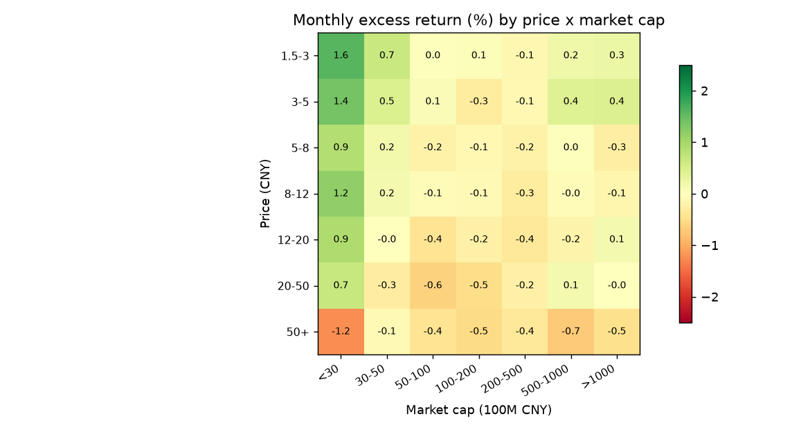
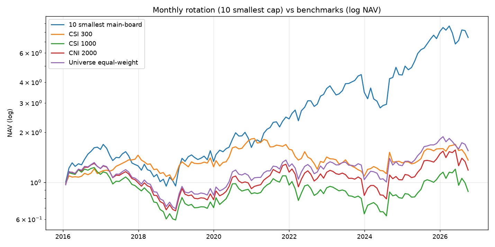
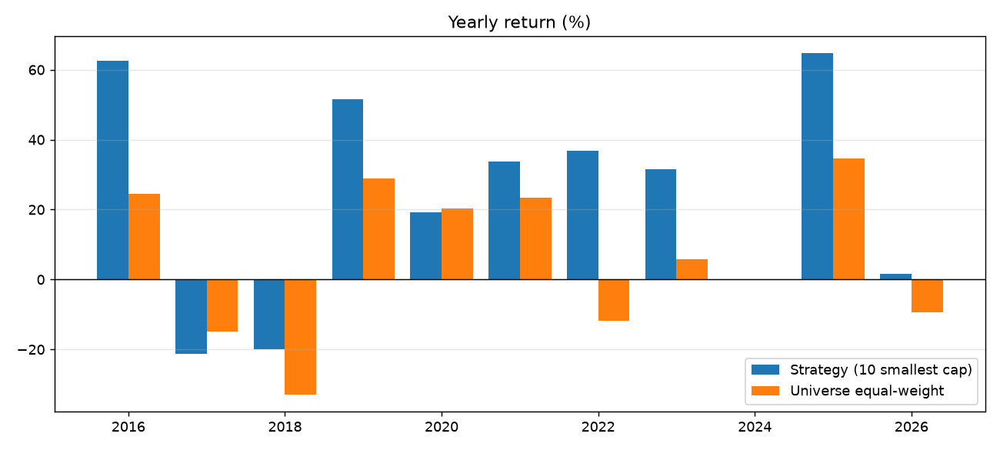

# 低价股 + 小市值策略：A 股 2016–2026 回测与研究

> 研究日期：2026-11-01 ｜ 数据：QuantDB 本地 parquet ｜ 复现：`scripts/backtest_low_price_small_cap.py`
>
> 结论先行：**这个风格长期有效，但它是「微盘 beta」而不是「低价 alpha」；收益高、回撤大、容量小，数据还存在系统性幸存者偏差。**
> 本文只做历史统计与工程验证，不构成投资建议。

---

## 0. 一句话结论

「10 元以下 + 50 亿以下、取最小市值 40 只、月度调仓」在 2016-01 至 2026-10 的独立回测里：

| 指标 | 低价 + 小市值 | 全市场等权 | 沪深 300 | 中证 1000 | 国证 2000 |
|---|---|---|---|---|---|
| 年化收益 | **20.66%** | 4.18% | 2.91% | -1.18% | 1.59% |
| 夏普（rf=2%） | **0.70** | 0.20 | 0.15 | 0.01 | 0.12 |
| 最大回撤 | **-43.90%** | -47.15% | -40.58% | -51.57% | -48.10% |
| 年化波动 | 30.4% | 24.3% | 20.3% | 26.2% | 25.9% |
| 月均换手 | 45.2% | 13.2% | — | — | — |

但同一个策略：

- **2017、2018 连续两年 -21% / -20%**，两年累计 -37%；
- **2024 年 1 月单月 -21.7%**（微盘踩踏）；
- **2024 年几乎零收益（-0.1%）**，而同期基准 +0.1%；
- 收益高度集中在 2021 年以后：**2021 起跑年化 30.8%，2017 起跑只有 17.3%**；
- 数据里**没有一只退市股**，而低价小市值正是退市率最高的一档——真实收益只会更低。

---

## 1. 策略定义（可直接复现）

### 1.1 股票池（每月末重算）

| 过滤项 | 规则 | 全样本剔除行数 |
|---|---|---|
| ST | `is_st != 1` | 11,865 |
| 退市风险 | `is_quit_risk != 1` | 5 |
| 面值退市 | 未复权股价 ≥ 1.5 元 | 957 |
| 流动性 | 5 日均成交额 ≥ 2,000 万元 | 53,921 |
| 新股 | 上市 ≥ 120 天 | 10,496 |
| 微盘壳 | 总市值 ≥ 10 亿元 | 7,753 |
| 板块 | 剔除科创板 688/689（50 万门槛） | 36,599 |
| 可成交 | T+1 停牌/一字涨停买不进、无下期开盘价 | 7,778 |

原始 519,501 行 → 可用 406,965 行，**月均池 3,155 只**。

### 1.2 选股与组合

```
低价:   未复权收盘价 ≤ 10 元          （价格中枢约 6.5 元）
小市值: 10 亿 ≤ 总市值 ≤ 50 亿        （持仓中位数约 17.7 亿）
排序:   总市值升序，取前 40 只
权重:   等权
调仓:   每月末（约 21 个交易日）
```

「低价 + 小市值」候选池：中位数 616 只/月，最少 10 只（2016-03），只有 3 个月不足 40 只。

### 1.3 时序与成本

- **信号**：T 日（月末）收盘计算，用 T 日可知的未复权价、总市值、成交额；
- **成交**：T+1 日**开盘**买入，持有到下次调仓的 T+1 日开盘卖出（无未来数据）；
- **收益**：后复权开盘价之比（含分红送转）；
- **成本**：单边 0.175%（佣金万 2.5 + 印花税万 5 卖出 + 过户费万 0.1 + 滑点 0.1%/边），月度换手 45.2% → 年化成本拖累约 **1.9%**。

---

## 2. 数据与口径（三个必须先说清楚的坑）

1. **`features_daily.close` 是后复权价，不能直接当「低价」用。**
   茅台 2024-12-31 后复权 1810.49 元，未复权 1524 元；老股票差得更多。
   本研究的「价格」一律取 `daily_unadjusted.close`；总市值取 `features_daily.total_mv`（内部按未复权价×总股本，口径自洽）。

2. **数据里没有退市股。**
   `research/stage0-数据与环境/day09-幸存者偏差` 已核实：本次回测用到的 5,224 只标的全部活到 2026-10，一只退市的都没有。
   低价小市值是**受这个问题影响最大的池子**——面值退市、财务退市的股票，退市前正是「几块钱、十几亿市值」。
   本报告的所有收益都应视为**上限**（第 5.4 节给量级估计）。

3. **parquet 分区的列类型会漂移。**
   `is_quit_risk` 在 2026 年分区是字符串 `'0'`，`fillna(0) == 0` 为 False，会把 2026 年数据**静默丢光**（首版脚本就踩了这个坑：129 期变成 120 期，年化虚高 2–3 个百分点）。
   脚本里统一 `pd.to_numeric(..., errors="coerce")` 后再比较。

另外已验证 `is_st` 是 point-in-time（600518 康美 2018 年为 0、2020 年起为 1、2026 年恢复 0），不存在「用现在的 ST 状态回填历史」的前视。

---

## 3. 证据一：价格 × 市值分组（它到底长什么样）



- 单元格 = 该组相对「同池等权」的**月均超额收益（%）**，2016-01 至 2026-10。
- **左下角最强**：1.5–3 元 × 30 亿以下 = **+1.59%/月**；3–5 元 × 30 亿以下 = +1.39%/月。
- **右上角最弱**：50 元以上 × 30 亿以下 = **-1.25%/月**（高价小微盘是负 alpha）；50 元以上整体为负。
- 价格维度在 30 亿以下分组里**整体向下**（越便宜越好，中间有噪声），市值维度在 20 元以下分组里也基本单调（越小越好）。
- 但**因子 IC 很弱**：价格 IC +0.038（ICIR 0.21）、市值 IC +0.022（ICIR 0.11）。
  说明收益不是来自稳定的截面排序，而是来自**极端尾部**（最小的 1% 股票）——这也解释了为什么组合只有 40 只时收益高、波动大、容量小。

---

## 4. 证据二：组合回测





### 4.1 逐年收益（自然年，按实际持仓月份归集）

| 年份 | 低价+小市值 | 全市场等权 |
|---|---|---|
| 2016（2–12 月） | +63% | +24% |
| 2017 | **-21%** | -15% |
| 2018 | **-20%** | -33% |
| 2019 | +52% | +29% |
| 2020 | +19% | +20% |
| 2021 | +34% | +23% |
| 2022 | +37% | -12% |
| 2023 | +32% | +6% |
| 2024 | **-0%** | +0% |
| 2025 | +65% | +35% |
| 2026（至 10 月） | +2% | -9% |

### 4.2 归因：低价和小市值各贡献了什么

| 组合（均 top40、月度、含成本） | 年化 | 夏普 | 最大回撤 |
|---|---|---|---|
| 仅低价（≤10 元，不限市值） | 19.80% | 0.68 | -43.90% |
| 仅小市值（≤50 亿，不限价） | 21.21% | 0.70 | -50.34% |
| **低价 + 小市值** | **20.66%** | **0.70** | **-43.90%** |

**读法：**

- 收益 = 小市值给的，低价没有增加年化（20.7% ≈ 低价的 19.8%，低于小市值的 21.2%）；
- 低价的真实作用在**回撤**：把小市值组合的 -50.3% 压到 -43.9%，并且排除了「高价小微盘」这个负 alpha 区（右上角 -1.25%/月）；
- 所以它更像「**小市值策略的低价风控版**」，不是「低价 + 小市值双因子增强」。

### 4.3 参数敏感性

| 变体 | 年化 | 夏普 | 最大回撤 |
|---|---|---|---|
| top20 | 24.47% | 0.78 | -46.39% |
| top30 | 23.16% | 0.76 | -43.50% |
| **top40（基准）** | 20.66% | 0.70 | -43.90% |
| top50 | 20.36% | 0.69 | -45.03% |
| top60 | 20.18% | 0.68 | -44.08% |
| 成本 = 0 | 22.96% | 0.76 | -41.64% |
| 成本 ×2 | 18.40% | 0.63 | -46.28% |
| 起点 2017 | 17.33% | 0.60 | -43.90% |
| 起点 2021 | 30.77% | 0.92 | -36.91% |

- 参数面平缓（top20–60 年化 20–24%），没有尖峰，不像过拟合；
- **成本敏感**：零成本 23.0% → 双倍成本 18.4%，成本吃掉约 4.6 个百分点；
- **时段敏感**：2021 年起年化 30.8%，2017 年起 17.3%，2016–2020 这段其实很平庸。把它当「永远 20%+」的策略会失望。

---

## 5. 风险与失效场景

### 5.1 历史三次重击

| 时间 | 单月/年度 | 当时发生了什么 |
|---|---|---|
| 2017 年 | -21% | IPO 加速 + 并购重组/壳价值监管收紧，小盘整体杀估值（同期 50 亿以下 -25%） |
| 2018 年 | -20% | 去杠杆 + 贸易摩擦，全面熊市（同期 50 亿以下 -29%） |
| 2024-01 | **-21.7%** | 微盘股流动性踩踏（量化 DMA/雪球/小盘拥挤），单月回撤超过 20% |

### 5.2 这不是「低风险」策略

年化波动 30%、最大回撤 -44%、月度胜率约 61%（但亏损月平均幅度更大）、最长连续 5 个月亏损；连续两年负收益发生过。
如果按 10% 仓位配置，对总组合的回撤贡献仍有 -4.4%；按 30% 配置就是 -13%。

### 5.3 容量：只有数亿元

- 持仓的 5 日均成交额中位数 **3,560 万元**（不是全市场，是这 40 只小票的中位数）；
- 月度换手 45.2%，等于每月要卖掉近一半仓位；
- 按单票不超过当日成交额 5% 估算，组合容量约 **3 亿元**；按 1% 则只有 **0.6 亿元**。
- 资金再大，冲击成本会把 20.7% 的年化吃光——这类策略天生是「小资金策略」。

### 5.4 幸存者偏差：真实收益要打折

数据里 0 只退市股，而现实中：

- 2016–2025 年 A 股累计退市约 200 家（仓库 D09 的统计口径）；
- 2024 年新「国九条」后，面值退市/财务退市明显加速；
- 退市前普遍跌 80–90%，且**低价小市值是退市率最高的池子**（股价越接近 1 元越危险）。

粗估：若池子年退市率 2%–4%、退市损失 85%，年化拖累 **1.7–3.4 个百分点**，且这些损失会集中出现在最差的月份——
**真实的最大回撤会比 -44% 更深，年化大概率落在 17%–19%，而不是 20.7%。**

### 5.5 换手与成本

月换手 45.2%（年 5.4 倍），双倍成本下年化掉到 18.4%。
实盘还有：涨跌停买不进/卖不出、停牌、100 股整手、最小佣金 5 元——小资金反而更友好，大资金更糟。
**本回测只建模了「买入侧」的停牌/一字涨停，没有建模「卖出侧」的跌停卖不出**——2024-01 那种连续跌停的月份，
真实亏损会比回测更深。

---

## 6. 如果要落成平台模板（as51 方向）

平台现有 `strategy_templates/as46_small_cap`（20–200 亿）和 `as47_micro_liquidity`（10–150 亿）都没有「绝对股价」维度
——因为平台侧 `features_daily` 的 `close` 是复权价，且 `f_*` 过滤器没有价格列。要落模板需要：

1. **自定义策略类**继承 `RedisRecordingStrategy`，在 `_adjust_signal(score, ref_date)` 里：
   - 用 `self._price_frame(symbols, ["$close", "$factor"], ...)` 取数，**`$close / $factor` 才是未复权价**；
   - 价格 > `price_max` 或市值越界的标的，打分置 `-inf`；
   - 其余按模型分排序，`topk=40`、`rebalance_days=20`。
2. **参数**：`price_max=10`、`f_total_mv_min=1e9`、`f_total_mv_max=5e9`、`f_amount_ma_5_min=2000`、`topk=40`、`n_drop=20`、`rebalance_days=20`。
   （`n_drop` 是单期最多替换数，40 等于每期全换；回测的月换手只有 45%，所以取 20 更贴近实际。）
3. **注意**：模板 docstring 里的回测记录必须用容器内 `scripts/run_ashare_backtest_all.py` 重跑生成，
   不能把本文的独立回测数字直接抄进去（模型不同、口径不同）。

---

## 7. 复现

```bash
# 默认：2016-01-01 ~ 2026-10-23，低价 ≤10 元、市值 ≤50 亿、top40、月度
python scripts/backtest_low_price_small_cap.py

# 换参数
python scripts/backtest_low_price_small_cap.py --price-max 8 --mv-max 3e9 --topk 30

# 出图 + 落 JSON
python scripts/backtest_low_price_small_cap.py --charts docs/images --json /tmp/lp.json
```

依赖：`duckdb` + `pandas`（`/root/quant/.venv` 已装），数据目录默认 `/opt/quantmind/data/quantdb`，可用 `--data-dir` 覆盖。
脚本不依赖 qlib / PG / docker，纯 parquet 计算，整轮约 20–30 秒。

---

## 8. 五问验收（按 `research/参考/验收清单.md`）

**① 用了未来数据吗？哪一行保证时序？**
没有。信号在 T 日收盘截面，收益用 T+1 开盘到下次 T+1 开盘，`fwd_ret = o_out/o_in - 1` 就是那两行；
脚本里没有 `shift(-N)`、没有 `fillna(bfill)`。
另外 T+1 停牌（volume=0）和开盘一字涨停（gap ≥ 9.5%/19.5%）的标的会被判为「买不进」，当月剔除。

**② 股票池怎么过滤？各剔掉多少？**
ST 11,865 行、退市风险 5 行、股价<1.5 元 957 行、成交额<2,000 万 53,921 行、上市<120 天 10,496 行、
市值<10 亿 7,753 行、科创板 36,599 行、T+1 停牌/一字涨停/无下期价 7,778 行；剩 406,965 行、月均 3,155 只。
停牌和涨停用「入场日成交量 + 开盘缺口」显式剔除，不再只靠成交额间接兜底。

**③ 成本算了几项？年换手多少？**
佣金万 2.5、印花税万 5（卖出）、过户费万 0.1、滑点 0.1%/边，合并单边 0.175%；月换手 45.2%，年化成本约 1.9%。
零成本对照 22.96%、双倍成本 18.40%。

**④ 回测区间？热启动怎么处理？**
2016-01-29 ~ 2026-10-23，129 期。月度策略只用当期截面，不需要热启动；
第一个信号日是 2016-01-29（建仓落在 2 月初），所以 2016 年只覆盖 2–12 月。

**⑤ 如果结果是假的，会先在哪个数字上露馅？**
三个地方：
（a）**2021 起 vs 2017 起**年化差 14 个百分点——收益高度依赖 2021 年后的微盘行情；
（b）**2024-01 单月 -21.7%**——真实回撤比表面更深；
（c）**幸存者偏差**——数据里没有退市股，而这类池子退市率最高，真实年化大概率比 20.7% 低 2–3 个点。

---

## 附：文件

- 回测脚本：[`scripts/backtest_low_price_small_cap.py`](../scripts/backtest_low_price_small_cap.py)
- 数据体检背景：[`research/stage0-数据与环境/day09-幸存者偏差/output.md`](../research/stage0-数据与环境/day09-幸存者偏差/output.md)
- 相关模板：[`strategy_templates/as46_small_cap.py`](../strategy_templates/as46_small_cap.py)（20–200 亿）、
  [`as47_micro_liquidity.py`](../strategy_templates/as47_micro_liquidity.py)（10–150 亿）
