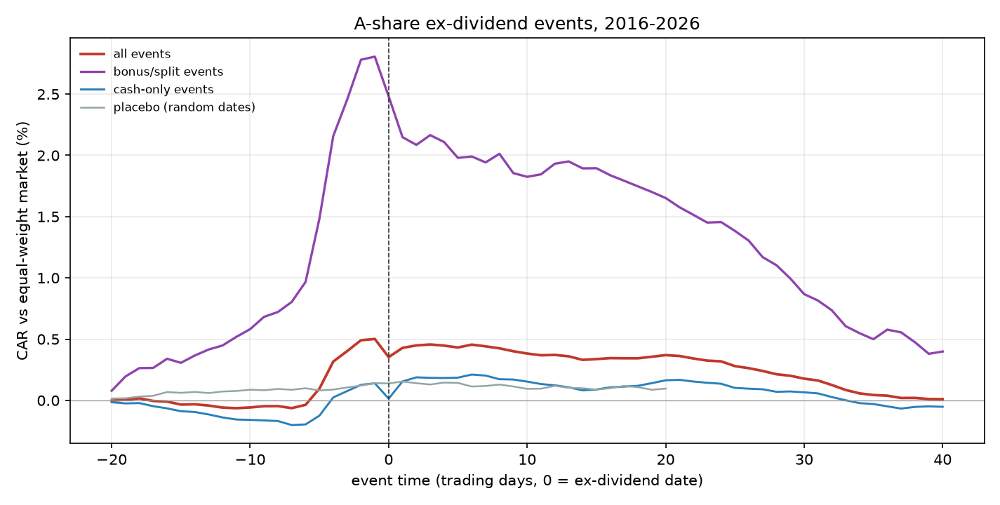
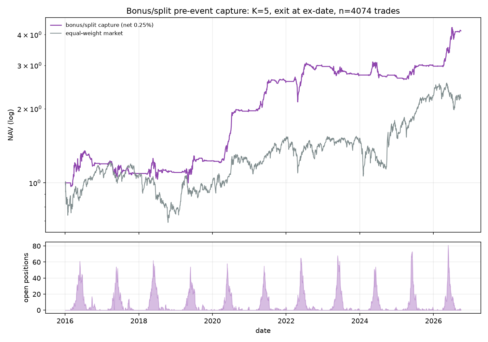

# 22 · 事件驱动 · 埋伏型：架构、顺序与验收

> 这份是「反复查」用的参考，不是某个学习日的作业。
> 适用于：公告 / 新闻 / 政策这类**文本源**，以及除权除息、解禁这类**日历事件**。

---

## 0 一句话

链路顺序是 **事件定义 → 时序对齐 → 事件研究 → 成本 → 组合**。
文本抽取（LLM）是**最后一段**，不是第一段。抽取得再好，事件定义错了、时序错了一天，回测就是假的。

---

## 1 三种事件，只有两种叫「埋伏」

| 类型 | 例子 | 日期提前知道？ | alpha 来源 | 需要文本？ |
|---|---|---|---|---|
| **事后型** | 业绩超预期后漂移（PEAD）、回购后漂移 | 否，事件后才知 | 信息扩散慢 | 否 |
| **日历型** | 除权除息、解禁、指数调整、股东大会 | 是，提前 5~30 天 | 规则约束 / 被动资金 | 否 |
| **语义型** | 公告利好、大额订单、诉讼、政策 | 否，只能预测 | 读得比别人快/准 | 是 |

**埋伏 = 日历型 + 语义型。** 事后型不叫埋伏，叫追。

---

## 2 形式化：三个乘数，三份钱

```
EV(t) = P(事件 ∈ (t, t+k] | 信息_t)      ← 命中率
      × E[异常收益 | 事件, 持有 h]        ← 事件收益
      − 成本(k, h)                        ← 换手/冲击/T+1
      − 已被提前定价的部分                ← 拥挤度
```

三个乘数对应三个子模型。**最常见的错误是把它们压成一个「持有 20 天」**，然后分不清赚的是「埋伏早」的钱还是「事件后漂移」的钱。

---

## 3 提前量 k 和持有期 h 是两个维度

- **k（提前几天进）**：由「事件日期什么时候公开」决定，不是拍脑袋。除权除息的实施公告提前 1~2 周，所以 k 最多到 10；再往前就是赌，不是埋伏。
- **h（事件后拿几天）**：由 **CAR 衰减曲线**决定。

正确做法：

1. 画 CAR(-20, +40)，看事件前有没有 pre-drift（有 → 市场在提前定价，你的 k 要往前挪，或者说明埋伏本身有信号）
2. 找 CAR 斜率变平的点（边际收益 < 边际成本 → 该走了）
3. 算半衰期：CAR 衰减到峰值一半要几天

**5/10/20 不是三选一。** 同时试三个再挑最大的，等于 3 倍多重检验 + 样本内最优，样本外必崩。

---

## 4 三类文本，难度差一个数量级

| | 公告 | 新闻 | 政策 |
|---|---|---|---|
| 量级 | 每天数千条 | 每天数万条（含转载） | 每天几条~几十条 |
| 信噪比 | 高，法定披露、模板化 | 低，重复、改写、标题党 | 高，但映射难 |
| 时间戳 | 精确到时分 | **模糊**：转载时间 ≠ 首发时间 | 精确，但发布 ≠ 生效 |
| 映射到个股 | 发行人直接对应 | 需实体链接 | 行业/概念板块 → 个股 |
| 赚什么 | **预期差** | **速度** | **广度**（轮动） |
| 顺序 | ① 第一个 | ② 第二个 | ③ 最后，先做板块级 |

---

## 5 文本层：point-in-time 是红线

回测只能用**你当时能看到的时间**（`first_seen_time`），不能用 `publish_time`。
新闻被转载、改写、延迟推送，用 publish_time 回测会凭空产生未来信息，而且极难发现。

```sql
-- 文本档案：一条原文一行，只增不改
CREATE TABLE doc_archive (
    doc_id       VARCHAR PRIMARY KEY,  -- 源ID + 源名
    source       VARCHAR,              -- cninfo / sse / szse / 财联社 / ...
    doc_type     VARCHAR,              -- announcement / news / policy
    symbol       VARCHAR,              -- 能确定的发行人（可空）
    publish_time TIMESTAMP,            -- 原文声称的发布时间
    first_seen  TIMESTAMP NOT NULL,    -- 我们抓到的第一时间 ← 回测只用这个
    url          VARCHAR,
    title        VARCHAR,
    raw_text     VARCHAR,
    content_hash VARCHAR,              -- 去重
    revision_of  VARCHAR,              -- 更正公告指向原 doc_id
    fetch_time   TIMESTAMP
);
```

配套要做、且容易被跳过的事：

- **去重**：同一公告被财联社/东财转载 → content_hash 收敛
- **更正公告**：新版本必须挂 `revision_of`，回测时用「当时最新的版本」
- **代码变更**：退市/更名/借壳，`symbol` 要能回溯到当时的口径
- **盘中 vs 盘后**：决定 T 日还是 T+1 才能买，这条直接决定收益

---

## 6 事件表：抽取的唯一产物

```sql
CREATE TABLE event (
    event_id    VARCHAR PRIMARY KEY,
    doc_id      VARCHAR,          -- 回指 doc_archive
    event_type  VARCHAR,          -- 枚举，先定 20 个，不要开放式
    symbol      VARCHAR,
    event_date  DATE,             -- 原文里的日期，不是抓取日期
    direction   VARCHAR,          -- pos / neg / neutral
    magnitude   DOUBLE,           -- 幅度（净利润变动%、回购金额…）
    magnitude_unit VARCHAR,
    evidence    VARCHAR NOT NULL, -- 原文片段，必填
    confidence  DOUBLE,
    extractor   VARCHAR,          -- rule_v3 / llm_gpt_x_v2
    prompt_ver  VARCHAR,
    extracted_at TIMESTAMP
);
```

`event_type` 先定一个**封闭枚举**（20 个左右）：业绩预告、业绩快报、回购、股东增持、股东减持、股权激励、重大合同、中标、诉讼、监管问询、ST 摘帽、并购重组、定增、可转债、分红、解禁、停牌、复牌、更名、实控人变更。
开放式「让模型自己发现事件类型」= 无法回测 + 事后叙事。

---

## 7 抽取红线（四条）

1. **每个字段必须带 evidence 原文片段**，且自动校验它是原文子串。校验不过 → 字段置空。这条同时防幻觉和防「模型用未来知识推断」。
2. **只许摘录 + 归类，不许推断**。「公司有望受益于…」一律丢弃。
3. **精度分层**（钱要花在 L1/L2）：

   | 层 | 内容 | 要求 | 错了的后果 |
   |---|---|---|---|
   | L1 | 事件是否发生、类型 | > 95% | 样本错，整个 CAR 失效 |
   | L2 | 时间戳 | 100%，只从原文/公告取 | 未来函数，回测全假 |
   | L3 | 幅度/方向 | 70~80% 够用 | 排序变差，不致命 |

4. **模型版本 + prompt 版本 + 抽取时间入库**。半年后要能一模一样重跑，否则「策略变好了」可能只是换了 prompt。

---

## 8 落地顺序（反直觉的部分）

| 段 | 事件 | 要不要 LLM | 产出 |
|---|---|---|---|
| **0** | 日历型：除权除息 / 解禁 / 财报披露日 | 不要 | 跑通 事件表 → CAR → 成本 → 组合 |
| **1** | 半结构化：业绩预告 / 业绩快报（公告里有固定字段） | 规则为主 | 第一条「文本→结构化」链路 |
| **2** | 公告全文 | 规则筛 + LLM 补长尾 | 事件类型扩到 20 个 |
| **3** | 新闻 | 需去重 + 实体链接 | 速度型信号 |
| **4** | 政策 | 映射到板块，不做个股 | 条件变量 / 轮动 |

**先规则、后 LLM。** A 股公告标题 70~80% 是模板化的，正则就能覆盖大半；LLM 只处理长尾。先用规则建立**可审计的 baseline**，才知道 LLM 提升了多少。

---

## 9 ML 的正确位置（三种，按推荐度）

1. **事件当特征**进全样本模型：`event_flag`、`days_to_event`、`magnitude`、`direction`
2. **事件样本内横截面排序**：同类事件里买哪只（逻辑回归 / 浅树 / 强正则）
3. **事件概率模型**：预测未来 k 天会不会发生 ← **埋伏的核心**

反例：几万条新闻 → 微调 BERT → 直接预测收益。标签噪声大、分布非平稳、样本外必崩。

注意：事件样本虽有几万条，但**高度聚集**（财报季、同行业同涨），有效样本远小于名义样本 → 统计要按**事件日聚类**，模型自由度要小。

---

## 10 三道门（不过就别往下走）

| 门 | 问题 | 不过怎么办 |
|---|---|---|
| 门 1 | 手工标 200 条，CAR 的 t > 2.5？ | t < 2.5 → 停，这个事件没有 alpha |
| 门 2 | 把抽取错误率注入 gold 集，模拟收益衰减 | 衰减 > 50% → 精度不够，先做规则 |
| 门 3 | 用当年的文本重跑，结果和当时一致？ | 不一致 → 有未来函数，回去查时间戳 |

多数人跳过门 2 直接上 LLM，结果「抽取 F1 0.9、策略不赚钱」，然后去调 prompt。

---

## 11 现在的数据能做什么

`quantdb` 里**没有任何文本表**；唯一带历史公告时间的字段是：

| 表 | 字段 | 能做什么 |
|---|---|---|
| `dividend_factors` | `time`（除权除息日） | 日历型事件，38k 条，可做 |
| `income` / `balance` / `cashflow` | `m_anntime`（实际公告日） | 财报事件；**预约披露日没有**，只能用去年同季推算 → 概率型埋伏 |
| `capital` | `m_anntime` + `restrict_circulating_capital` 跳变 | 解禁事件 |
| `instrument_detail` | `NoticeDate_Recent` / `RecentHGDate` / `RecentReleaseDate` | **只有「最近一次」快照，不能回测** |
| `index_weights` | 无时间维度 | 快照，有幸存者偏差，**不能回测指数调整** |
| `sector_concept` | 无时间维度 | 同上，概念映射不能回测 |

结论：公告 / 新闻 / 政策这条路，**第一步是建文本库（带 first_seen），不是建模型**。

---

## 12 第一个参照系：除权除息（已跑）

工具：`tools/event_study.py`；复现：`python tools/build_event_cache.py && python tools/run_dividend_car.py`（组合层用 `tools/run_dividend_backtest.py`）

样本 2016-01 ~ 2026-09，36,962 个事件（含送转 5,106 / 纯现金 31,856），基准 = 全市场等权。



**口径自检**：除权日当天，前复权平均日收益 -0.11%，不复权 -5.60%（高送转 -31.7%）
→ 证实 `dividend_factors.time` 就是除权除息日，且必须用前复权。

### 三条结论

1. **全样本那 0.5% 全是送转贡献的。** 纯现金分红在事件前后都没有可交易收益（±0.2%，t < 2）。
2. **送转是「抢权—贴权」**：除权前 3 天加速上涨，事件日 CAR +2.48%（t=7.5）；除权后一路回落，+20 日只剩 +1.65%。
3. **事件后持有是负贡献**（见下表）：买在 -1 日或 0 日，持有 5/10/20 天全是负的。

| 买入日 \ 持有 | 5 日 | 10 日 | 20 日 |
|---|---|---|---|
| -10 | +0.90% (t=6.0) | +1.94% (t=6.8) | +1.24% (t=1.1) |
| -5 | +1.01% (t=4.2) | +0.49% (t=-1.2) | +0.32% (t=-1.8) |
| -1 | -0.63% (t=-7.5) | -0.91% (t=-7.3) | -1.10% (t=-6.4) |
| 0 | -0.51% (t=-5.4) | -0.69% (t=-5.2) | -0.88% (t=-4.1) |

（含送转子样本，市场调整后，t 按事件日聚类）

### 两个必须记住的读数

- **安慰剂**：同一批股票、随机日期，CAR 也有 +0.14%（t=2.0）
  → 聚类 t 值偏乐观（窗口重叠 + 事件日聚集），真实显著性要对折看。
- **逐年（事件研究口径，非组合收益）**：送转抢权 2016–2025 每年都在（+1.0% ~ +2.0%）；
  2026 只有部分样本（+6.2%），别当结论。

### 对「5/10/20 天后」的回答

在送转这个事件上：**事件后一天都不该拿**。
窗口不是选出来的，是 CAR 曲线直接给出来的——事件后曲线向下，任何 h 都是负的。

### 补完：可成交性 / 成本 / 组合层



**过滤漏斗**（K=5，卖除权日）：5,048 个事件 → 可交易 **4,074（80.7%）**。
买不进（涨停/停牌）1.8%，卖不出 3.3%，日均成交额 < 3000 万 15.1%。

**交易层**：平均毛收益 1.32%，中位 0.58%，胜率 54.4%，板块超额 1.24%。
安慰剂（同批股票随机日期）超额只有 0.24% → 真实超额约 1.0%。

**组合层**（12 个仓位、每仓 1/12，信号超额时按比例缩到满仓，扣 0.25% 往返）：

| 配置 | 笔数 | 均持仓 | 资金占用 | 净年化 | 夏普 | 回撤 |
|---|---|---|---|---|---|---|
| K=2，卖除权日 | 4,090 | 6.7 | 21% | -6.1% | -0.46 | -61% |
| K=3，卖除权日 | 4,085 | 8.8 | 26% | +1.0% | 0.14 | -41% |
| K=5，卖除权日 | 4,074 | 12.6 | 32% | +14.7% | 0.99 | -26% |
| **K=5，卖登记日(-1)** | 4,133 | 11.3 | 29% | **+21.4%** | **1.43** | **-16%** |
| K=10，卖除权日 | 4,099 | 21.3 | 40% | +18.2% | 1.08 | -23% |
| 基准（全市场等权） | — | — | — | +8.0% | 0.44 | -43% |

三个必须看懂的读数：

- **资金占用只有 29~40%**：这是季节性策略，一年只在 5–7 月的送转季有仓，其余空仓。
  账户级年化 21% 是「含空仓」的数字，别拿它和满仓策略比。
- **对入场时点极敏感**：K=2 是 -6.1%，K=5 是 +14.7%。抢权效应集中在 -5 ~ -2，晚三天就没了。
- **卖在登记日（-1）好于卖除权日**：回避了除权当天的贴权，回撤从 -26% 降到 -16%。

**分段（净年化）**：

| | 策略 | 全市场等权 |
|---|---|---|
| 2016–2020 | +15.0% | +3.9% |
| 2021–2022 | +24.0% | +6.7% |
| 2023–2026 | **+9.7%** | **+14.5%** |

2023–2025 连续跑输（2023 -7.7%、2024 -1.8%、2025 +10.6% vs 市场 +40.3%），
2026 又反弹（+39.2% vs -1.8%，但只有 9 个月）。
**超额在 2023 年后不稳定**，不能当成可持续的策略。

**送转力度**：≤3 股档超额 1.48%、3–6 股档 1.46%，6–10 股只有 0.47%、>10 股 0.44%。
**高送转反而不灵**，和「高送转必炒」的直觉相反（被重点监管、预期打得更满）。

**成本与容量**：盈亏平衡往返成本 ≈ 1.17%（资金占用低，成本被摊薄）；
单笔 100 万 ≈ 日均成交额的 0.87%（中位），44% 的笔超过 1%；
单笔 300 万时中位 2.6%、80% 超过 1% → 个人账户合理上限约单笔 50~100 万。

### 结论：参照系，不是策略

这条线证明了三件事：

1. **链路能跑通**：事件 → 事件研究 → 可成交性 → 成本 → 组合 → 分段 → 安慰剂
2. **一个看起来很强的信号可以被完整证伪**：漏斗砍 20%、入场晚三天变负、2023 后超额消失、高送转反而不灵
3. **「事件后持有几天」这种问题，在数据面前往往不成立**：真正的钱在事件前的 3~5 天里

所以它是**参照系**：后面每个新事件都拿它比——如果新事件的可交易比例、盈亏平衡成本、
分段稳定性都不如它，就不值得做。

### 下一步（按顺序）

1. 第二个日历事件：**解禁**（`capital` 里 `restrict_circulating_capital` 跳变，日期可提前知道）
2. 第一个文本事件：**业绩预告**（`income.m_anntime` 先对齐时间戳，再上规则抽取）
3. 再回头看：送转这条线要不要做成组合的一部分（大概率不要，2023 后没有超额）

---

## 13 第一个复合实验：业绩预告

为什么选它：

- 每年 5000+ 条，样本够
- 半结构化：预增/预减、净利润变动幅度、原因分类，字段 3~5 个
- 有强制披露规则，时间是确定的
- 有 PEAD 文献支撑，结果真假好判断

流程：

```
抓公告(2016–2026) → 规则筛「业绩预告」 → 抽(类型, 幅度, 原因)
→ 对齐公告时间 → CAR(-5, +20) → 按幅度/市值分组 → 扣成本
```

---

## 14 常见死法

| 死法 | 症状 | 根因 |
|---|---|---|
| 用 publish_time 回测 | 收益好得不真实 | 转载/延迟 → 未来函数 |
| 事件类型开放 | 无法复现 | 每次跑出来不一样 |
| 让 LLM 判断利好利空当因子 | 不可审计、随时间漂移 | 把模型输出当数据 |
| 三个窗口挑最好 | 样本外崩 | 多重检验 |
| 只有「事件发生」的样本 | 高估收益 | 埋伏必须包含「没发生」的样本 |
| 事件样本直接喂 LightGBM | 训练集完美、实盘崩 | 样本聚集 + 自由度太大 |
